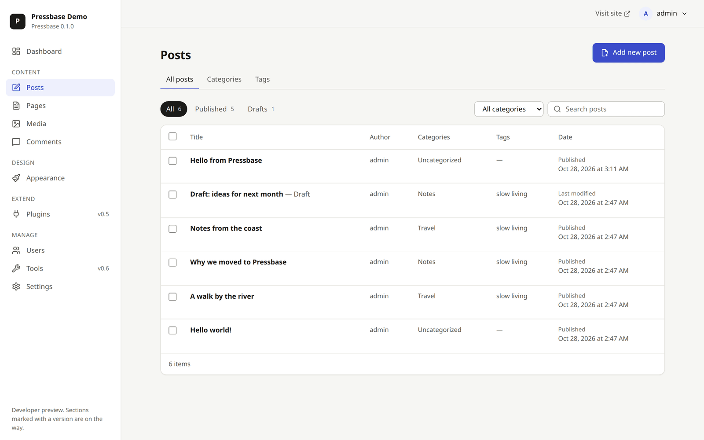

# Pressbase documentation

These docs live with the code and change in the same pull requests. If a doc is wrong, that's a bug: fix it or open an issue.

<picture>
  <source media="(prefers-color-scheme: dark)" srcset="assets/screenshots/posts-dark.png">
  
</picture>

New here? The [README](../README.md#see-it-in-action) shows Pressbase in action: the block editor, Twenty Twenty-Five style variations, the public site and the admin. Screenshots live in [`assets/screenshots/`](assets/screenshots/); when a change alters a screen shown there, update the image in the same pull request.

## Product

- [Vision and principles](vision.md): why Pressbase exists, who it's for, and what it won't do.
- [Roadmap](roadmap.md): what ships in each release and what's next.

## Architecture

- [Overview](architecture/overview.md): processes, request flow, boot sequence, repository layout.
- [WordPress → Pressbase map](architecture/wordpress-mapping.md): where each WordPress concept lives.
- [Database](architecture/database.md): tables, how columns map from WordPress, migrations.
- [Content](architecture/content.md): post types, statuses, taxonomies, queries, permissions, sanitising.
- [Media](architecture/media.md): uploads, storage, image sizes, file serving and its security.
- [Hooks](architecture/hooks.md): actions and filters, and the hooks core fires.
- [Jobs and cron](architecture/jobs.md): the job queue, its worker, WP-Cron and scheduled posts.
- [Blocks](architecture/blocks.md): parsing, rendering, dynamic blocks and patterns.
- [People](architecture/people.md): users and roles, application passwords, mail, password reset.
- [Comments](architecture/comments.md): the comment pipeline, moderation, blocks and the comment form.
- [Themes and the public site](architecture/themes.md): theme.json, block themes, routing, the template hierarchy and page rendering.
- [The public site: caching, feeds, sitemaps](architecture/public-site.md): the page cache and its invalidation, RSS and Atom feeds, XML sitemaps, robots.txt, permalink settings.
- [Public page hooks, scripts and styles](architecture/scripts-and-styles.md): `wp_head`, `wp_body_open`, `wp_footer`, `kernel.scripts` and `kernel.styles`.
- [Plugins](architecture/plugins.md): writing a plugin, plugin.json, the lifecycle, installing, the security model and its limits.
- [REST API](architecture/rest-api.md): endpoints, errors, authentication.
- [Block editor](architecture/block-editor.md): how Gutenberg runs in the admin, api-fetch, hidden blocks, autosave.
- [Internationalisation](architecture/i18n.md): text domains, `.mo`/`.po`/JSON files, the site's and users' languages, language packs, RTL, translating the admin and the block editor.
- [Installer](architecture/installer.md): site states, the install flow, configuration.
- [Security](architecture/security.md): threat model and protections.

## Design

- [Principles](design/principles.md): how we decide what good looks like.
- [Tokens](design/tokens.md): colour, type, spacing, motion.
- [Components](design/components.md): the UI kit and when to use each piece.
- [Information architecture](design/information-architecture.md): admin navigation and screens.
- [Accessibility](design/accessibility.md): the standard and a review checklist.
- [Voice and tone](design/voice-and-tone.md): how Pressbase talks.

## Development

- [Getting started](development/getting-started.md): run Pressbase locally.
- [Testing](development/testing.md): what to test and how.
- [Conventions](development/conventions.md): code style and patterns.
- [Writing plugins](development/writing-plugins.md): `create-pressbase-plugin`, the SDK, building and packing a plugin.
- [Translating Pressbase](development/translating.md): contributing a translation, `pnpm i18n:extract`, making strings translatable.

## Decisions

- [Architecture Decision Records](adr/README.md): the reasoning behind big choices.
