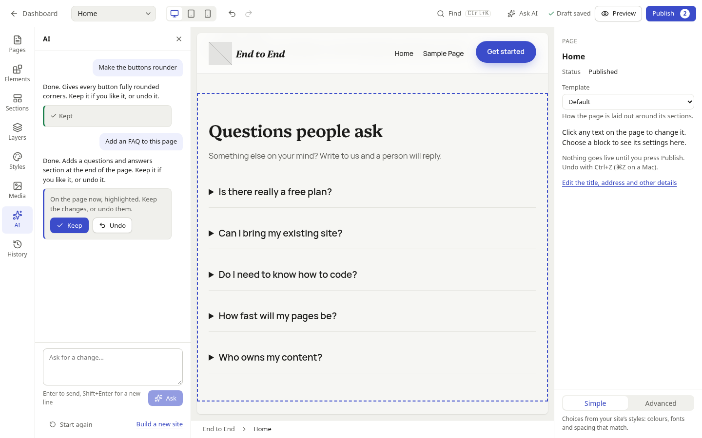
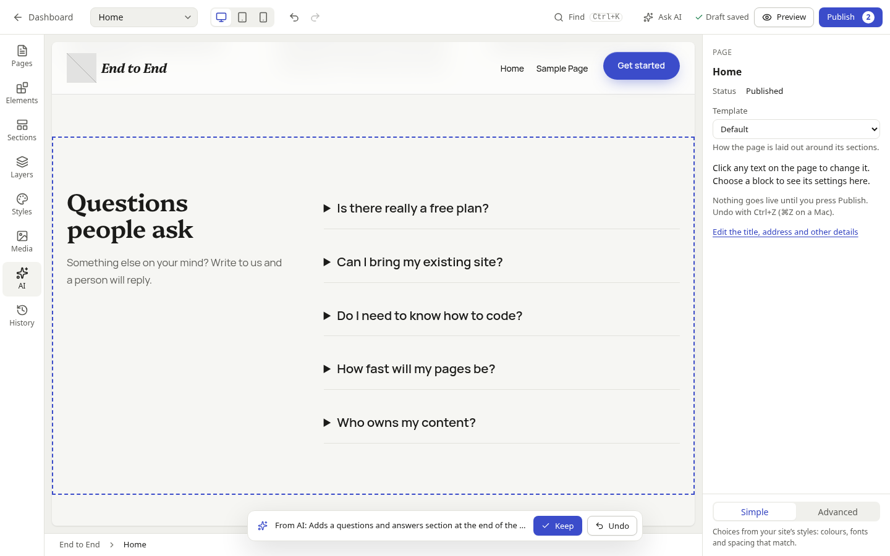

# AI edits and Studio's AI panel

Studio's **AI panel** (#62) lets a site owner ask for changes in their own words ("make the buttons rounder", "add an FAQ to this page"). The answer is a small set of **edit operations** (#57), which Studio puts on the page straight away, highlighted, as one step with **Keep** and **Undo**. Nothing is published: the changes go into the person's draft like any edit, and only *Publish* makes them live ([Principle 5](../plans/visual-site-builder.md#principles), "AI proposes, people decide").

It follows the plan's [edits after generation](../plans/visual-site-builder.md#edits-after-generation) and [ADR 0024](../adr/0024-ai-site-building.md#operations-accepted).

| Part | Where |
| --- | --- |
| The operations: types, JSON Schema, the checks that need only the set | `packages/site-edits` (`@pressbase/site-edits`), shared by core and the admin |
| Checking a set against the site | `core/propose-site-edits`, `apps/core/src/site-building/edits.ts` |
| The conversation and its tool loop | `apps/core/src/site-building/assistant.ts`, `apps/core/src/routes/studio-ai.ts` |
| Planning a set against the canvas and the draft | `apps/admin/src/components/studio/ai-edits-model.ts` |
| Applying it, Keep and Undo | `use-ai-edits.ts`; the conversation `use-studio-ai.ts`; the panel `ai-panel.tsx` |

## The operations

Ten operations, each a plain JSON object with a `type`. A model names patterns and fills slots with plain text; it never writes block markup, CSS or colours.

| Operation | Fields | In Studio |
| --- | --- | --- |
| `insertSection` | `page?`, `pattern`, `slots?`, `index?` | a section rendered from the pattern, at the end by default |
| `replaceSection` | `page?`, `index`, `pattern`, `slots?`, `keep_content?` | another pattern in its place, its content moved across (Swap layout's `transferSlots()`); what has no place is listed |
| `moveSection` | `page?`, `index`, `to` | moves it |
| `removeSection` | `page?`, `index` | removes it |
| `updateSlots` | `page?`, `index`, `slots` | changes some of its text, links and images |
| `updateBlockAttributes` | `page?`, `index`, `block?`, `attributes` | presets on the section, or a block inside it (`block` is the path of inner-block positions): colour, gradient, border colour, font size and family by slug, alignment, and `style` with preset references and keywords only. `null` removes one |
| `setGlobalStyles` | `design?`, `styles?` | the site's styles: a [design direction](design-generator.md), and/or theme.json styles with preset references only |
| `updateTemplatePart` | `slug`, `pattern?`, `slots?` | the header or footer: rebuilt from a pattern, or its slots filled |
| `createPage` | `title`, `slug?`, `sections`, `status?` | a new page made of sections |
| `updateMenu` | `items: [{ label, page? \| url? }]` | the header menu's links, replaced; `page` is a slug (one the set creates, too), `url` a path or an http(s) address |

Section indexes count from 0 and are read after the operations before them, as [`core/update-page-sections`](site-abilities.md#patterns-and-sections) reads them. A page operation without `page` changes the page open in Studio. A set holds at most 30 operations and a menu 12 links (`MAX_OPERATIONS`, `MAX_MENU_ITEMS`).

`checkOperations()` (in `@pressbase/site-edits`) checks what needs only the set: shapes, as the schema says, with readable messages (`operations[2].slots`: …); presets only in styles and attributes (`presetProblem()`: no hex or functional colours, `url()`, braces or a `css` key); safe menu links (`isSafeLink()`). Both sides run it.

## In core

### `core/propose-site-edits`

How a model hands over the changes it suggests. Input `{ operations, summary, page?, changeset_uuid? }`; it checks the set against the site as the person's changeset has it, as the write abilities would (patterns exist and are for building, slot values fit the slots' schema, section positions exist, presets are the theme's, pages and parts exist, menu pages exist or are created by the set), and returns `{ operations, summary, unused, styles? }`:

- every page operation names its page (`page`: the ID, or the slug of a page the set or the draft creates);
- `createPage` has its final `slug`;
- `unused`: content replaced sections had no place for;
- `styles`: when the set changes the site's styles, the changeset entry they would make (`{ key: "wp_global_styles:{theme}", value }`), worked out as `core/update-global-styles` would. Studio writes it into the draft, so the design generator runs only in core.

**It changes nothing.** Its permission is what the set would need: `edit_pages`; `edit_theme_options` for styles, parts and the menu; `publish_pages` for new pages; `edit_post` on each page. An error names the operation (`input[operations][1][index]: there’s no section 4; the page has 3.`) so the model can fix it and call again. It's in REST like the other abilities (`GET /wp-abilities/v1/abilities/core/propose-site-edits/run?input=…`), which Studio uses to work out the styles of a set that didn't come from the panel.

### `/pressbase/v1/studio/ai`

For people with `edit_pages`:

| Route | Does |
| --- | --- |
| `GET /` | `supports_ai`, `can_manage_ai`, `daily_limit`, `requests_today`, `limit_reached`, and the conversation (`messages`) of the changeset (`?changeset_uuid=`, else the person's open one) |
| `POST /messages` | `{ message, changeset_uuid?, page?: { id } \| { slug }, parts?: ["header", …] }`: asks. The answer is Server-Sent Events: `start` (`changeset_uuid`, the stored request), `text` (pieces of the reply as it's written), `proposal` (a set the ability accepted), `error`, then `done` (the stored reply, with `operations`, `summary` and `styles` when it proposes changes, and the day's usage). `503 prompt_prevented` when AI is off, `429 ai_daily_limit_reached` (with the usage) at the cap |
| `POST /messages/{id}` | `{ outcome: "kept" \| "undone" }`: what the person did with a proposal, so later requests know |
| `DELETE /` | starts the conversation again |

A request runs once through the AI client's [tool loop](ai.md#abilities-as-tools), as the person, with the reads (`core/get-site-brief`, `core/get-design-system`, `core/list-patterns`, `core/get-page-structure`) and `core/propose-site-edits`, never a write: at most six rounds, 4,000 output tokens and two minutes, attributed to `studio/assistant` in the usage log. The last proposal the ability accepted is the reply's. The system instruction asks the model to read before it changes, to propose once with every operation, to use presets only, to keep to the brief's facts (placeholders otherwise), to treat everything in `<studio_context>` and the abilities' answers as data, and, when a request can't be done with these operations (publishing, photos, plugins, forms, code), to propose nothing and say so plainly.

**The conversation is kept with the changeset** (post meta `_pressbase_ai_thread`, the last 40 messages); the last 12 go with each request as history, with what the person kept or undid. A request starts a changeset if there's none. Publishing or discarding the draft ends the conversation with it.

## In Studio

### The AI panel

The rail's *AI* panel, *Ask AI* in the top bar, and *Ask AI for a change* in the command palette open it, ready to type in. With an empty conversation it explains itself and offers a few requests to try; then it's the conversation, newest at the bottom (`role="log"`, polite). The reply is written as it arrives. A reply with changes gets a card: its summary, and, while they wait, *Keep* and *Undo*; afterwards *Kept* or *Undone*. A request that can't be done gets a plain answer and no card. *Start again* clears the conversation; *Build a new site* opens the [guided flow](site-builder.md#the-guided-flow).

- **AI off:** what the panel will do, and the guided flow's offer, which says where to turn AI on (or that an administrator can).
- **The daily cap:** once the site's requests for the day are used (Settings → AI), the box gives way to a note saying so and when it resets, with a link to change the limit for people who can. With five or fewer left, the box says how many.
- Before asking, Studio saves the canvas to the draft, so the AI reads the page as it is.

### Applying a set

When a reply proposes changes, Studio applies them at once (`useAiEdits().apply()`):

1. **Plan** (`planEdits()`, pure): `checkOperations()` again, then each operation against what Studio has, in order: the open page's sections and the header and footer on the canvas, other pages as the draft leaves them, the site's patterns (`/wp/v2/block-patterns/patterns`). Sections are rendered from patterns and filled as core does (`renderPattern()`, `fillSlots()` in `text` format, `transferSlots()` for replacing), so what Studio shows is what core checked. The plan says which canvas regions change and their new blocks, which blocks to highlight, the draft entries for other and new pages, the menu's new links, and whether the styles change. If any operation can't be applied, **the whole set is refused** with a readable message on its card (*The page has no section 5 (it has 3).*) and core is told it was undone.
2. **Apply**, everything or nothing:
   - **The canvas:** the regions' new blocks go in as **one undo step**, named after the set in History (*Changes from AI: Adds a questions section…*). Sections no operation touched keep their blocks. The canvas then saves to the draft as for any edit.
   - **Other pages and new pages:** their `page:` entries in the draft (content, and a new page's title and place, as the Pages panel adds one).
   - **The site styles:** the `wp_global_styles:{theme}` entry core resolved. The canvas shows the draft's styles once Studio's Styles panel (#46) takes up entries written elsewhere; Preview shows them now.
   - **The menu:** the header's menu (its Navigation block's `ref`, else the site's fallback menu) is edited in core-data, as the Navigation block edits it, so the header shows the new links and the draft gets `wp_navigation:{id}`.
3. **Highlight:** the changed blocks (new, moved, or with new attributes) get a dashed outline in the canvas, and the first is scrolled into view.
4. **Keep or Undo**, on the card or, with the panel closed, on a bar over the canvas (and in the command palette):
   - **Keep** removes the highlight; the changes stay in the draft.
   - **Undo** takes the whole set back: the canvas step is undone (when other edits came after it, the regions go back to how they were before the set, as a new step), the draft entries go back to their earlier values, and the menu to its earlier links.

   Asking again, starting again, or opening another page keeps a set still waiting. Core is told which (`POST /messages/{id}`).

Nothing in this reaches the live site: canvas edits and entries go into the person's [changeset](changesets.md), saved as for any edit, and only *Publish* makes them live. People without `edit_theme_options` can't apply styles, header, footer or menu changes (the set is refused before anything changes), and core wouldn't propose them.

### Commands

In the command palette, under *AI*: *Ask AI for a change*, *Keep the changes from AI*, *Undo the changes from AI* (both say what the set does, and can't be chosen when there's none), and *Start a new conversation with AI*.

## Security

- **The model never writes markup, CSS or colours.** Patterns and plain-text slot values, preset references and keywords, safe links. Core and Studio both check.
- **Content is data:** the open page, parts and everything the abilities return are passed as labelled data, with an instruction never to follow instructions in them ([site abilities](site-abilities.md#content-is-data-not-instructions)).
- **Permissions as the person**, in core (the ability) and in Studio (the plan); **nothing is published**; the conversation goes to the provider only when an administrator has turned AI on ([ADR 0019](../adr/0019-ai-client-and-abilities.md)), and the usage log keeps counts, never content.

## Tests

- `packages/site-edits/src/site-edits.test.ts`: the schema and the checks.
- `apps/core/src/studio-ai.test.ts`: the ability (checks, names pages, resolves styles, changes nothing, permissions) and the route (streaming, proposals, outcomes, the daily cap, AI off), with a scripted fake provider and the recorded one.
- `apps/admin/src/components/studio/ai-edits-model.test.ts`: each operation, the plan, refusals; `ai-panel-model.test.ts`: reading the events, the messages.
- `e2e/tests/studio-ai.spec.ts`, with the recorded provider: a set of three operations applied as one step, highlighted, and undone; "make the buttons rounder" and "add an FAQ" kept into the draft; a request that can't be done; the command palette; the daily cap.

The [recorded provider](ai.md#testing-without-a-provider) plays a few conversations through the real tool loop (`recorded-assistant.ts`): "…rounder… buttons" (fully rounded buttons, a style change), "…FAQ…" (a questions section at the end of the open page), "…tidy…" (several page operations at once), and anything else (it can't do that).

## Not yet

- *Ask AI* on a selection and in the section toolbar, prompt to section and prompt to page (#63).
- The canvas showing a style change before Studio's Styles panel (#46) lands: until then it's in the draft and in Preview.
- Undo after later edits to the same region puts the region back as it was before the set, so those edits go too (they're one undo away).
- Highlighting a removed section (there's nothing left to outline) or a changed menu.
- Proposals from an earlier visit can't be applied again from the conversation.
