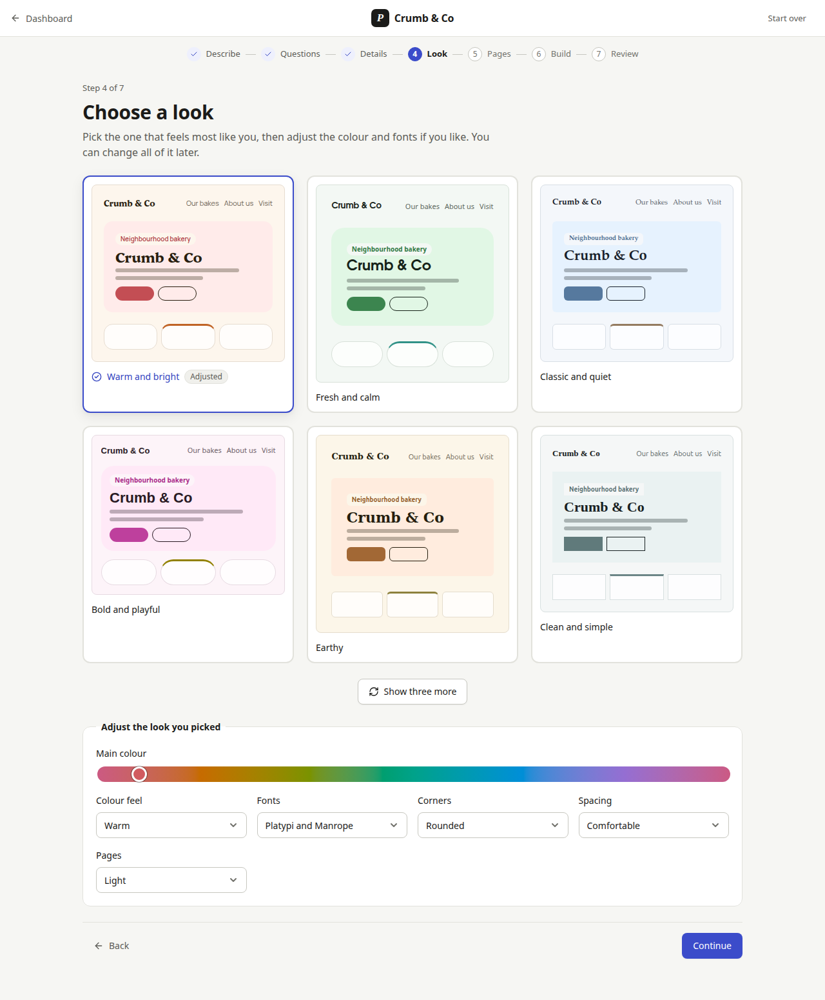
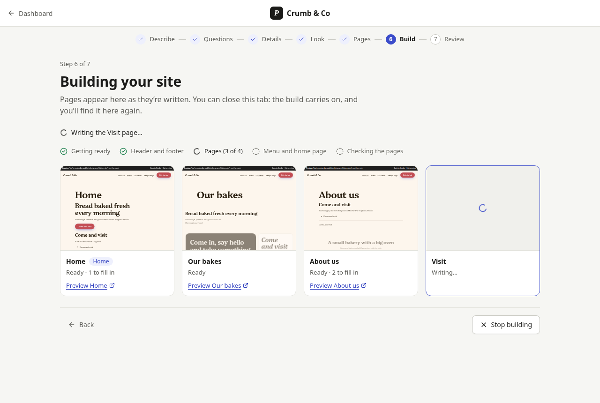

# The site builder

"Build my site from a prompt": a person describes their site, and Pressbase writes a brief, a design, a sitemap and every page into a [changeset](changesets.md) they review in Studio and publish themselves. It follows the [plan](../plans/visual-site-builder.md#building-with-ai) and [ADR 0024](../adr/0024-ai-site-building.md#pipeline-accepted). The [guided flow](#the-guided-flow) in the admin (#60) is built on the API below. Once a site exists, Studio's [AI panel](ai-edits.md) takes requests for changes in the person's own words (#62), using the same abilities, and still offers *Build a new site*.

Code: `apps/core/src/site-builder/` (`pipeline.ts` the stages, `steps.ts` the guided flow's steps before a run, `honest.ts` the honest-content rules, `runs.ts` the run record, `index.ts` the job), `apps/core/src/routes/site-builder.ts`. Tests: `apps/core/src/site-builder.test.ts`, `site-builder-steps.test.ts`; `e2e/tests/prompt-to-site.spec.ts`.

## The pipeline

A fixed pipeline in code, not a free-running agent. Each stage is one structured call: the AI client's `asJsonResponse(schema)` with the stage's JSON Schema, parsed and validated (`parseStructuredOutput()`, as `generateJson()` does), then checked in code. An answer that doesn't fit is **retried once**, with what was wrong; a second bad answer fails the stage.

| Stage | Request (`forAbility`) | The model answers | Done in code |
| --- | --- | --- | --- |
| Brief | `site-builder/brief` | the brief (`SITE_BRIEF_JSON_SCHEMA`) | The form's facts first; the model's facts kept only where the person's own words support them; name and pages from the form win |
| Design | `site-builder/design` | a design direction (`DESIGN_CHOICE_SCHEMA`, font pairs limited to the theme's) | `core/update-global-styles`: the palette is generated from the hue and checked against WCAG AA |
| Sitemap | `site-builder/sitemap` | `{ pages: [{ title, slug, sections: [{ category, intent }] }], header, footer }` | Categories limited to those with patterns; slugs cleaned and made unique; at most 8 pages of 8 sections; the first page is the home page |
| Page (one call each, three at a time) | `site-builder/page` | `{ section_1: { pattern, slots }, … }`: for each section, one of up to four patterns of its category, and its slots | Honest content, then `core/create-page`, which checks the slots against the pattern and renders the blocks |
| Assemble | — | — | Header and footer through `core/update-template-part`; a menu of the pages; the home page; the brief |
| Check | — | — | `runCheckPage()` on every page, against the changeset's styles |

A five-page site is eight requests. When the person already went through a step in the guided flow (an edited brief, a chosen design, an arranged sitemap), they pass it when starting the run and the stage makes no request; an arranged sitemap still needs one request for the header and footer (`site-builder/parts`).

Every write goes through the [site-building abilities](site-abilities.md) as the person who started the run (`kernel.abilities.context(user, 'ai')`), so their rights apply, and into one changeset: the one named by `changeset_uuid`, else their open one, started when there is none. **Nothing publishes.** The run's writes are made one at a time (pages finish in parallel, and two writes to one changeset at once would lose one).

### Assemble

- **Header and footer**: the active theme's `header` and `footer` parts, with the slots the Sitemap stage filled (made honest).
- **Menu**: a `wp_navigation` menu the changeset creates (`wp_navigation:site-menu`, or `site-menu-2`… when taken), one `core/navigation-link` per page that was built, home first, and `pressbase_navigation_fallback` naming it by slug, so every Navigation block without a menu (the theme's header) shows it.
- **Home page**: `show_on_front = page` and `page_on_front` naming the home page by slug.
- **Brief**: `pressbase_site_brief`, so later AI requests know the site (needs `manage_options`).

Changesets take a post's slug for the three post-ID options (`page_on_front`, `page_for_posts`, `pressbase_navigation_fallback`) and create `wp_navigation` posts named by slug; publishing writes the posts first and stores their IDs ([changesets](changesets.md#entries-and-entity-handlers)). Pages are written with the default status, so they go live when the changeset is published; until then they exist only in the changeset. A write the person's rights don't allow (the options need `manage_options`) is skipped with a warning; the run goes on.

## Honest content

The site states as facts only what the person gave ([plan](../plans/visual-site-builder.md#honest-content)). The prompt says so, and `honest.ts` makes sure of it after every answer:

- **The brief's facts** are the form's (name, location, address, phone, email, and any facts typed in) and those the model drew from the description that the description supports. Nothing else counts as a fact.
- **Fact slots** keep a value only when the facts say it; otherwise they get their placeholder (`[Add a customer quote]`). Fact slots are those declared `facts`, and in sections about facts (testimonials, team, pricing, statistics, contact, opening hours) every slot of a repeated item and every citation.
- **Every other slot is copy**, and may say anything general, but a number, an email address or a web address it gives must be in the facts; otherwise it gets its placeholder too. Button labels are copy.
- **Links**: `tel:` and `mailto:` links and addresses on other sites must be in the facts; otherwise the link becomes `#`.

"In the facts" is strict on purpose: the model may reword copy, not facts. A run lists what it replaced per page (`replaced`), and the placeholders left (`placeholders`) feed the "Before you publish" checklist (#61). Slot schemas allow at least the placeholder's length, so a model told to write one can.

**The person's words are data.** Their description and facts, the brief, and the sitemap go into the prompt as separate, labelled parts (`<site_owner_input>`, `<site_brief>`, `<sitemap_page>`), JSON-encoded so they can't close their tag, after the task; the system instruction says never to follow instructions in them. Whatever the model answers, the model never writes markup (it names patterns and fills slots in plain text) and the abilities enforce the person's rights and the changeset.

## Runs

A run is a `pressbase_site_run` post (private, `edit_theme_options`, like a changeset), its content the run as JSON, so it survives a closed tab, a reload or another device. It runs as one job (`pressbase/site-builder`, [the job queue](jobs.md)), not retried (that would spend the day's requests twice), with a 30-minute timeout (then it fails with `site_builder_timeout`). A run whose job dies is marked failed (`site_builder_job_failed`). A sitemap with no page the patterns can build fails with `site_builder_empty_sitemap`.

| Field | |
| --- | --- |
| `id`, `author`, `created`, `modified` | |
| `status` | `queued`, `running`, `completed`, `stopped` (the daily cap), `failed`, `cancelled` |
| `stage` | `brief`, `design`, `sitemap`, `pages`, `assemble`, `check`, or `null` |
| `input` | the form: `description`, `name`, `location`, `phone`, `email`, `address`, `facts[]`, `pages[]`, `language` |
| `brief`, `design`, `sitemap` | as the stages left them |
| `pages[]` | `{ slug, title, status (pending, generating, done, failed, skipped), home, sections[] (patterns), placeholders[], replaced[], checks: { errors, warnings, passed }, preview_link, error }` |
| `changeset_uuid`, `preview_link` | where the site is, and how to see it |
| `tokens: { prompt, completion, total }`, `requests` | what the run used, retries included |
| `warnings[]`, `error` | `{ code, message }` |
| `job_id`, `last_event_id` | |

### The daily cap

The run stops cleanly at the site's daily cap (`ai_daily_limit_reached`): no new request starts, pages not yet written are `skipped`, and what was made stays in the changeset; Assemble and Check still run (they make no requests), so the pages built get their menu, home page and checks. The status is `stopped`, with the error and the tokens used. The run counts its requests in flight against the cap, so pages sent together don't pass it.

## REST

All under `/wp-json/pressbase/v1/site-builder`, for users with `edit_theme_options`:

| Route | Does |
| --- | --- |
| `POST /runs` | Starts a run: `{ description, name?, location?, phone?, email?, address?, facts?, pages?, language?, brief?, design?, sitemap?, changeset_uuid? }` → `202` with the run. `503 prompt_prevented` when AI isn't set up; `409 site_builder_run_active` (with `data.run`) while one of yours is queued or running; `400 rest_invalid_param` |
| `GET /runs` | Your runs, newest first |
| `GET /runs/{id}` | The run (yours, or anyone's for `manage_options`). With `Accept: text/event-stream`, its progress as Server-Sent Events |
| `DELETE /runs/{id}` | Stops it: a queued run is cancelled at once; a running one before its next request (`202`) |
| `GET /status`, `POST /clarify`, `/brief`, `/designs`, `/sitemap` | The guided flow's [steps before a run](#steps-before-a-run) |

### Progress events

The stream starts with a `snapshot` event (the run, without an ID), then sends the run's events in order, each with an increasing `id`, and ends after `done`. A reconnecting `EventSource` sends `Last-Event-ID` (or pass `?after=`) and gets only what it missed; a finished run replays and closes. Comments (`: keep-alive`) are sent every 15 seconds while nothing happens. `GET` needs no `X-Pressbase-Request` header, so a browser's `EventSource` works with the session cookie.

| Event | Data |
| --- | --- |
| `run` | `{ status, changeset_uuid, preview_link }` |
| `stage` | `{ stage, status: 'started' \| 'done' }` |
| `retry` | `{ stage, problem }` |
| `brief` | `{ brief }` |
| `design` | `{ design, palette }` |
| `sitemap` | `{ sitemap }` |
| `page` | `{ slug, title, status }`; when `done`, also `preview_link`, `sections`, `placeholders`, `replaced`; when `failed`, `error` |
| `part` | `{ slug, replaced }` (header, footer) |
| `menu` | `{ slug, items }` |
| `home` | `{ slug }` |
| `warning` | `{ code, message }` |
| `checks` | `{ slug, errors, warnings, passed, findings }` |
| `done` | `{ status, tokens, requests, changeset_uuid, preview_link, error }` |

## The guided flow

*Build my site* in the admin (#60): seven steps at `/admin/studio/build`, full-screen like Studio, for people with `edit_theme_options`. Code: `apps/admin/src/components/site-builder/` (`prompt-to-site.tsx` the steps, `design-preview.tsx`, `sitemap-editor.tsx`, `build-offer.tsx` the offers, `studio-note.tsx`), the arithmetic in `apps/admin/src/lib/site-builder.ts` (tested in `site-builder.test.ts`); core's side in `apps/core/src/site-builder/steps.ts`.

| Step | The person | Core |
| --- | --- | --- |
| 1. **Describe** | One text box (*What's your site for?*), and under *Add your details*: name, town, phone, email, address, other facts (one per line), a logo and photos | — (uploads go to `/wp/v2/media`) |
| 2. **Questions** | At most three questions, each optional; *Skip questions* | `POST /clarify`; none asked when the description is enough, and the step is skipped |
| 3. **Details** | The brief as a card: name, kind, audience, tone, the facts the site may state | `POST /brief` (the answers count as the person's words) |
| 4. **Look** | Three live mini previews, *Show three more*, then colour (a hue slider), colour feel, fonts, corners, spacing, light or dark pages | `POST /designs`; previews drawn in the browser with `@pressbase/design` (`createDesign()`), the same palette core writes |
| 5. **Pages** | Pages in menu order (drag, or the arrow buttons), add (up to 8) and remove pages, add and remove sections | `POST /sitemap`, with the kinds of section the site's patterns can build |
| 6. **Build** | Stages and page cards; each page appears, as a scaled preview of the draft, when it's written. *Stop building* | `POST /runs` with `brief`, `design` and `sitemap`, then the run's events (`EventSource`, with a JSON poll every 5 s as a fallback) |
| 7. **Review** | Pages built, *N things to fill in before you publish*, what the AI used, *Preview*, *Review in Studio* | — |

| Step | Screenshot |
| --- | --- |
| Describe, Questions, Details | [describe](../assets/screenshots/prompt-to-site-describe.png), [clarify](../assets/screenshots/prompt-to-site-clarify.png), [brief](../assets/screenshots/prompt-to-site-brief.png) |
| Look (light and [dark](../assets/screenshots/prompt-to-site-dark.png)), Pages | [design](../assets/screenshots/prompt-to-site-design.png), [sitemap](../assets/screenshots/prompt-to-site-sitemap.png) |
| Build, Review, Studio | [generate](../assets/screenshots/prompt-to-site-generate.png), [review](../assets/screenshots/prompt-to-site-review.png), [studio](../assets/screenshots/prompt-to-site-studio.png) |
| Where it's offered | [dashboard](../assets/screenshots/prompt-to-site-dashboard.png) |

- **Back always works.** Each step keeps what was typed; going back and forward asks the model again only when what it was asked from changed (the description, the answers, the brief). Back while building asks first, then stops the run; Back from Review goes to Pages, and building again writes into the same draft.
- **Closing the tab loses nothing.** What the person typed is kept in this browser (`localStorage`, `pressbase-site-builder`) until the build starts; from then the run is in core: the address has `?run=`, and opening the flow with a run in progress (`GET /status`'s `active_run`) follows it again, replaying its events.
- **The logo** goes into the same draft as the site, as `option:site_logo`, for people with `manage_options` (the run is started with that `changeset_uuid`); otherwise, like the photos, it's saved to the media library. Image slots don't use uploads yet (see [Not yet](#not-yet)).
- **Review → Studio** opens `/admin/studio?changeset_uuid=…&run=…`: the draft's home page (`page_on_front` names a new page by slug; `draftReading()` follows it), with a note above the canvas: *N things to fill in before you publish*, page by page, each opening its page. The full checklist is #61; the canvas shows the new styles once #46 lands (Preview shows them now).
- **AI use**, in words: *10 AI requests, about 7,100 tokens (roughly 5,300 words read and written)*: the flow's steps (each answer's `usage`) plus the run's `tokens` and `requests` from `done`.
- **Where it's offered** (`BuildOffer`): after the installer when AI is set up (an environment key and Settings → AI), on the dashboard of an empty site (the installer's sample page and post only) or while a run is in progress, and in Studio's AI panel until #62. With AI off it says so, with a link to Settings → AI for people with `manage_options`.

### Steps before a run

Each is one structured request (`site-builder/clarify`, `…/brief`, `…/designs`, `…/sitemap` in the usage log), with the pipeline's system instruction, the person's words labelled as data, the answer checked against its schema and **retried once**; a second bad answer is `502 prompt_invalid_output`. Each counts against the daily cap and answers with its `usage: { tokens, requests }`. All need `edit_theme_options`; AI off is `503 prompt_prevented`, the cap `429 ai_daily_limit_reached`.

| Route | Body | Answer |
| --- | --- | --- |
| `GET /status` | — | `{ supports_ai, can_manage_ai, max_pages, max_questions, active_run }`: whether to offer the flow, and a run to resume |
| `POST /clarify` | the form (as `POST /runs`) | `{ questions: [{ question }] }`: at most 3, distinct, maybe none |
| `POST /brief` | the form, `answers?: [{ question, answer }]` | `{ brief }`: as the Brief stage writes it (the form's facts first; the model's kept only where the description or an answer says them); empty answers are left out |
| `POST /designs` | `{ brief, shown?: DesignChoice[] }` | `{ designs: [{ label, choice }] }`: three directions, font pairs limited to the theme's; asked again (once) when two are the same; `shown` asks for new ones |
| `POST /sitemap` | `{ brief }` | `{ sitemap, sections: [{ category, label }] }`: pages as the Sitemap stage plans them (normalised), and every kind of section the patterns can build |

A run started with all three (`brief`, `design`, `sitemap`) asks only for the header and footer (`site-builder/parts`) and the pages. So a four-page site from the flow is about ten requests: one each for the four steps, one for the header and footer, one per page.

### Usability test plan

The issue asks for notes from two people who haven't built a site before. Until those sessions happen, this is the plan for them.

- **Who:** at least two people who run something small (a shop, a club, a practice) and have never built a website; not developers. One on a laptop, one on a phone-sized window if possible.
- **Setup:** a fresh install with AI on (a real provider, with a capped daily limit), the facilitator's screen recorded with consent. No demonstration beforehand.
- **Task:** "Make a website for your [business], so people can find you and see what you do. Stop when you'd be happy to show it to a friend." Think aloud; the facilitator only answers "what would you do?".
- **Watch for:** where they hesitate or re-read (the description box, the questions, the facts card, choosing a look, sections in Pages); whether they understand the draft (nothing is live until Publish) and the gaps in square brackets; whether Back and *Stop building* do what they expect; whether they find the gaps from the note in Studio; words they don't know (any "block", "template", "changeset" that slips through is a bug).
- **Measure:** time to a published site; steps where they went back; questions skipped; gaps filled before publishing; how they rate "this looks like my business" (1 to 5).
- **After:** two questions: "What surprised you?" and "What would you change first?". Notes go in a comment on #60, with issues filed for anything blocking.

## Not yet

- Images (uploads and Openverse) for image slots, which keep the pattern's for now; the flow's photos are saved to the media library only.
- Usability notes from people building their first site (the [plan](#usability-test-plan) above).
- Retrying a failed page alone, and a run resuming after its process dies.
- Matching facts by meaning rather than by words: a fact the model rephrases becomes a placeholder.
