# Studio

Studio is Pressbase's site editor: a full-screen screen at `/admin/studio` where a site owner edits their pages in the real theme, header and footer included. It does what WordPress's *Appearance → Editor* does, with the direct feel the [plan](../plans/visual-site-builder.md#the-screen) describes. The decision to build our own editor around `@wordpress/block-editor`, rather than use `@wordpress/edit-site`, is in [ADR 0021](../adr/0021-site-editor-and-templates-storage.md#studio-shell).

This page covers the shell (#28), saving through the user's draft (#31), the header and footer in place (#30), the Pages panel (#29), the Elements panel (#35), the Sections panel and section toolbar (#44), Swap layout (#45), Simple and Advanced modes (#32), the command palette (#33), the History panel (#34), the AI panel and AI edits (#62, #57, in [AI edits](ai-edits.md)), Ask AI (#63, in [AI edits](ai-edits.md#ask-ai)), the "Before you publish" checklist (#61, in [quality checks](quality-checks.md#before-you-publish)), [responsive editing](#responsive-editing) (#49), [Layers](#layers) (#50), and where the rest of v0.8 plugs in.

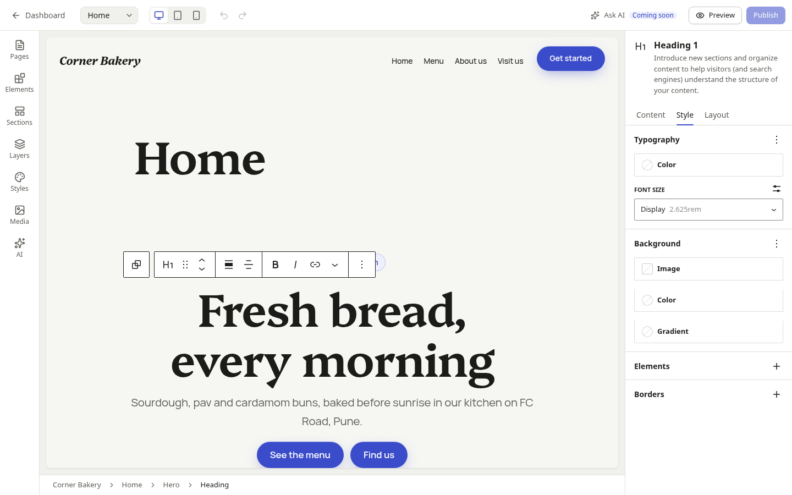

## Opening Studio

- **Route:** `/admin/studio`, capability `edit_theme_options` (as `site-editor.php`), or `edit_pages` to work on pages only: see [People without design rights](#people-without-design-rights). Anyone else sees a notice and a way back.
- **Edit with Studio:** a row action on each page in *Pages*, and a button in the editor's top bar for a saved page (it asks first if there are unsaved changes). Both open `/admin/studio?page={id}`.
- **Menu:** its own item, *Design → Studio* (`lib/sections.ts`). *Appearance → Editor* (the Appearance tab, and `/admin/appearance/editor`) leads here.
- **Full-screen:** `AdminShell` renders `/admin/studio` without its sidebar and top bar (`isFullScreen()` in `components/shell/admin-shell.tsx`), keeping the toasts, the current user and plugins' UI modules.
- **Which page:** `?page={id}` opens that page; without it, the home page: the static front page (`show_on_front: page`), or the latest posts. The address follows the page picker, so a reload reopens the same page (a page the draft adds has no ID yet, so it isn't in the address). The reading settings come from the REST index (`show_on_front`, `page_on_front`, as WordPress's `get_index()` gives them to anyone), so people without `manage_options` open the right home page too.
- **Which draft:** the user's open changeset (`GET /pressbase/v1/changesets`), or the one `?changeset_uuid=` names (a preview's *Back to Studio* link). See [Saving](#saving-the-draft-publish-preview-discard).
- **After building a site** (`?run=`, [the guided flow](site-builder.md#the-guided-flow)): the draft's home page opens (its `page_on_front` names the new page by slug, and `draftReading()` and `frontPage()` follow it), with a note above the canvas of what's left to fill in, page by page (`studio-note.tsx`).
- **Loading:** `components/studio/index.tsx` loads Studio with `next/dynamic` (`ssr: false`) after the editor's translations, like the post editor.

## The screen

```
┌ TopBar ───────────────────────────────────────────────────────────────────────┐
│ ← Dashboard  [Home ▾]  [▭ ▯ ▯]  ↶ ↷  ⌕ Find ⌘K  ✦ Ask AI  ✓ Draft saved  Preview  [Publish 2] │
├ Rail ┬ Panel ─────────┬ Canvas (iframe) ─────────────────────┬ Inspector ──────┤
│Pages │ Pages          │  ┌ Header · all pages ────────────┐   │ Heading 3       │
│Elem. │ Home     Home  │  └────────────────────────────────┘   │ Content Style   │
│Sect. │ Menu           │   Fresh bread, every morning          │ Layout          │
│Layers│ About us       │  ┌ Footer · all pages ────────────┐   │ Typography …    │
│Styles│                │  └────────────────────────────────┘   │                 │
│Media │ (#29 note)     ├ Breadcrumb: Site › Home › Hero › Heading │                 │
│AI    │                │                                       │                 │
│Hist. │                │                                       │ Simple◉Advanced │
└──────┴────────────────┴───────────────────────────────────────┴─────────────────┘
```

| Part | Component | What it does now | Built out by |
| --- | --- | --- | --- |
| Top bar | `top-bar.tsx`, `publish-panel.tsx` | Back to the dashboard; the page picker (a native `<select>` of the page tree, plus *Home (latest posts)* when there's no static front page); Desktop / Tablet / Mobile (the canvas sized inside the theme's breakpoints, [Responsive editing](#responsive-editing)); undo and redo; *Find* (the [command palette](#command-palette), #33); *Ask AI* (opens the [AI panel](ai-edits.md#the-ai-panel), #62); whether the draft is saved; Preview; *Publish N* with the list of changes, what's left on the [checklist](quality-checks.md#before-you-publish) (#61) and *Discard all*; publishing with things left asks first | — |
| Left rail | `rail.tsx` | Nine panels; the open one sits beside the canvas (over it on narrow screens). Escape closes it and returns focus to its button | see below |
| Canvas | `studio.tsx`, `regions.tsx` | The page in its template, in the active theme; the header and footer editable in place | #35–#37 |
| Breadcrumb | `breadcrumb.tsx` | Site › Page › Section › Block for the selection; each step selects that level | — |
| Inspector | `inspector.tsx` | Nothing selected: the page (status, its template to choose, how to edit). A template part: that it's on every page, and *Reset to theme* once it differs from the theme's. A block: its card, *Show on* (and on Tablet or Mobile what it changes there, [Responsive editing](#responsive-editing)), and the Content / Style / Layout tabs, under a note when it sits in a part; a section also gets [Swap layout](#swap-layout) (#45). At its foot, [Simple and Advanced](#simple-and-advanced) (#32) | — |

### Left rail panels

Listed in `RAIL_PANELS` (`layout-model.ts`). A built panel (`interim: 'built'`) gets its content from Studio; the others name the issue that builds them out, so nothing looks broken:

| Panel | Today | Issue |
| --- | --- | --- |
| Pages | Built (#29): the page tree; add, rename, reorder and nest pages, choose the home page. See [The Pages panel](#the-pages-panel) | — |
| Elements | Built (#35): blocks as large tiles, grouped, searchable, click or drag to add. See [The Elements panel](#the-elements-panel) | — |
| Sections | Built (#44): the section library, searchable, click or drag to add. See [The Sections panel](#the-sections-panel) | — |
| Layers | Built (#50): everything on the page as a tree; drag, or Alt and the arrow keys, to move and nest; rename; hide per device. See [Layers](#layers) | — |
| Styles | Built (#46, #47): the site's design system, each block's styles, Additional CSS and the style book. See [The Styles panel](#the-styles-panel) | — |
| Media | A note | #58 |
| AI | Built (#62): ask for changes in your own words; each set goes on the page highlighted, with Keep and Undo; *Build a new site* ([the guided flow](site-builder.md#the-guided-flow), #60). With AI off, where to turn it on. See [AI edits](ai-edits.md) | — |
| History | Built (#34): this session's steps, then the published versions. See [History](#history) | — |
| Checklist | Built (#61): "Before you publish": placeholders to fill, images to choose and checks that failed, across every page and part in the draft; each opens its page and selects its block. `?panel=checklist` opens Studio on it. See [Before you publish](quality-checks.md#before-you-publish) | — |

### Inspector tabs

`INSPECTOR_TABS` (`layout-model.ts`) puts each of `@wordpress/block-editor`'s `InspectorControls` groups in one tab (a test checks every group is placed exactly once):

| Tab | Groups |
| --- | --- |
| Content | `default` (block settings), `content`, `list`, `bindings`, `advanced` (collapsed) |
| Style | block style variations, `styles`, `typography`, `color`, `background`, `elements`, `border`, `effects`, `filter` |
| Layout | `layout`, `dimensions`, `position` |

The inspector renders `InspectorControls.Slot` for the active tab's groups, so a block's own controls and block supports appear without Studio knowing about them; plugin blocks' controls too. A tab with nothing for the selected block says so. [Simple and Advanced](#simple-and-advanced) (#32) narrow these lists per mode (`modeTabs()`).

The inspector's controls are WordPress's, so they sit in a light scope in dark mode, like the post editor's Block tab.

## The canvas

### One block tree

The canvas is the page's template with its *regions* filled in (`canvas-model.ts`, `composeCanvas()`):

- each `core/template-part` block gets the part's blocks (from `/wp/v2/template-parts`) as inner blocks;
- the first `core/post-content` block gets the page's blocks (from `/wp/v2/pages/{id}`).

So the whole canvas is one `BlockEditorProvider` value with one undo history (`useStateWithHistory`, as in the post editor), and undo and redo cover every edit on the screen. WordPress's own site editor keeps each part and the page as separate core-data entities with their own edits; one tree is simpler and makes the [changeset](changesets.md) the single place where edits are split per entity.

Both region blocks save as self-closing comments (their `save` returns `null`), so serializing the template gives back the template unchanged, and a region's inner blocks are that entity's content. `regionBlocks()` reads each region back out: the page's blocks (`pageBlocks()`) and each part's, by slug (the first copy, when a part shows twice); `findRegions()` lists them in order.

Inside Studio, both blocks edit as plain containers of their inner blocks (`regions.tsx`, an `editor.BlockEdit` filter active only under `StudioRegionsProvider`), with the tag and classes the public site renders: `<header class="wp-block-template-part">` for a header part, `<div class="entry-content wp-block-post-content">` for the content. A part also gets its label (*Header · all pages*) as a real element in the canvas, shown on hover and while it or anything in it is selected; clicking it selects the part as a whole. The post editor keeps WordPress's components.

### Which template

`templateCandidates()` (`site-model.ts`) follows core's template hierarchy for the page (`apps/core/src/frontend/hierarchy.ts`): `front-page` for the home page, then the page's chosen template, `page-{slug}` (URL-encoded first), `page-{id}`, `page`, `singular`, `index`. The latest posts use `front-page`, `home`, `index`. `pickTemplate()` takes the first one `/wp/v2/templates` lists, customised copies included. WordPress's editor makes the same choice in the browser.

Template-part blocks get the template's `theme` attribute when the canvas is built, as WordPress adds it when reading a template, so the block editor's labels find the part.

### What can be edited

`editingModes()` sets the block editing modes (`setBlockEditingMode()`):

| Where | Mode | Why |
| --- | --- | --- |
| The template (root) | `disabled` | The template's own blocks (the page title, the featured image, the layout groups) are shown, not edited |
| The page's content (`core/post-content`) | `default` | Everything in the page is editable inline |
| A template part | `default` | The header and footer are edited in place (#30). With `partsEditable: false` (people without `edit_theme_options`, #29) its blocks are `disabled`: the part is selectable as a whole but locked |

Locked blocks without anything to show on the site (no featured image, no site logo) are hidden in the canvas (`canvas.css`). In an editable part, the site logo block shows its placeholder, so a logo can be added. Sections from unsynced patterns stay fully editable (`disableContentOnlyForUnsyncedPatterns`).

### Which blocks

`editorSettings({ context: 'studio' })` offers the site-editing blocks the post editor leaves out (`STUDIO_BLOCKS` in `block-editor/blocks.ts`): `core/template-part`, `core/post-content`, `core/site-logo`, `core/site-title` and `core/site-tagline`. Everything else in `UNSUPPORTED_BLOCKS` stays out of both (`blocks.test.ts`).

### Styles

The iframe gets WordPress's content styles (`STUDIO_CANVAS_STYLESHEETS`: the post editor's list without `canvas.css` and the classic `block-library-theme.css`), then the active theme from `GET /wp-block-editor/v1/settings`:

- `styles`: the global stylesheet (preset variables, preset classes, theme styles, custom CSS), passed to `BlockCanvas`, which scopes it to the canvas as WordPress does;
- `__unstableResolvedAssets.styles`: the theme's `@font-face` rules, block style CSS and stylesheets;
- `__experimentalFeatures` and the derived settings: the theme's palette, font sizes and spacing in the inspector.

The block list has the `wp-site-blocks` class, so the theme's root layout rules apply as on the site. `studio-canvas.css` adds only the admin's focus colour and the template part outline and label.

### Devices

Desktop, Tablet and Mobile set the canvas frame's width from the theme's breakpoints (`deviceFrames()` in `responsive-model.ts`, see [Responsive editing](#responsive-editing)). The iframe is that wide, so the theme's media queries apply.

## Responsive editing

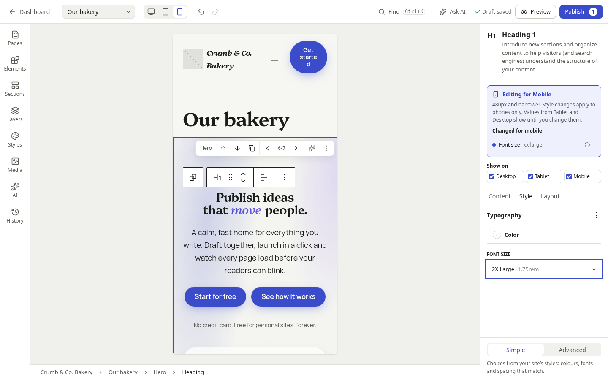

#49 brings Elementor's responsive mode, on WordPress 7.1's data ([ADR 0023](../adr/0023-responsive-styles-and-breakpoints.md)): a block's `style["@tablet"]` and `style["@mobile"]` beside its base style, `metadata.blockVisibility`, and the theme's `settings.viewport` breakpoints (480px and 782px unless the theme says otherwise). Core already renders all three; Studio edits them. `responsive-model.ts` holds the data and pure functions (tested), `responsive.tsx` the wiring and the inspector's parts.

**The canvas.** `deviceFrames()` reads `__experimentalFeatures.viewport` (sanitised as `sanitize_viewport_settings()` does) and sizes the canvas inside each range: 768px for Tablet and 390px for Mobile when they fit, else the breakpoint itself. A size the theme has no breakpoint for isn't offered. Each device button's tooltip gives its range (*Mobile: 480px and narrower*). The block editor is told the device too (`deviceTypeKey`), so a block hidden on it leaves the canvas unless it's selected.

**Values per device.** On Tablet or Mobile, `StudioResponsive` sets the block editor's style state viewport (`setStyleStateViewport('@mobile')` and `setResponsiveEditing(true)`, private APIs opened in `block-editor/private-apis.ts`). WordPress 7.1's style panels (typography with colour, background, dimensions, border, elements) then read and write `style["@mobile"]`, and the canvas prints those values in their media queries. This works in Simple and in Advanced: the device switch is in the top bar for everyone, and a change made while looking at a phone shouldn't change the computer's. On those sizes the Style and Layout tabs keep only those panels (`deviceTabs()`). Style variations, shadows and duotone have one value for every size, and the public site doesn't print per-device layout and position yet. Content edits are the same on every size.

**Values inherit downward** (Desktop → Tablet → Mobile). Desktop's values are the base style and reach every size through CSS. WordPress's ranges don't overlap, though: `@tablet` is `(480px < width <= 782px)`, so in CSS a tablet value never reaches a phone. Studio copies values instead, in an `editor.BlockEdit` filter around `setAttributes` (`inheritDown()`), so the stored result renders the same in WordPress:

| Edit | What's stored |
| --- | --- |
| A value set on Tablet | in `@tablet`, and in `@mobile` where Mobile had nothing or had Tablet's old value |
| A value removed on Tablet | from `@tablet`, and from `@mobile` where Mobile had copied it |
| A value reset on Mobile | Tablet's value again when Tablet has one; otherwise nothing, so Desktop's shows |
| A value set on Desktop | the base style, as before |

A Mobile value equal to Tablet's counts as inherited, not as a change of Mobile's own.

**What changed, with a reset.** On Tablet or Mobile, the inspector shows *Editing for Mobile* with the range, then *Changed for mobile*. Each value the block has for that size is listed with a dot, its name in plain words (`propertyLabel()`: *Font size*, *Padding (top)*), its value (a preset's name) and a reset (*Reset Font size for mobile*, `resetDeviceValue()`). *Reset all for mobile* appears when there are several. Values Mobile takes from Tablet are listed as *From Tablet: …*, without a dot. WordPress's own panels show the same values, with their own reset.

**Show on.** Under the block's card, on every device, *Show on* offers Desktop, Tablet and Mobile as checkboxes (in Simple too). Unticking one writes `metadata.blockVisibility: { viewport: { mobile: false } }` (`withBlockVisibility()`); ticking all three removes it. When the block is hidden on the size shown, a note says it shows here while it's selected; when it's hidden on every size, the note says visitors won't see it. It isn't offered for blocks with `supports.visibility: false`, locked blocks, the template's regions, or themes with `blockVisibility.allowEditing: false`. Layers offers the same checkboxes, and its rows show WordPress's hidden icon.

**Site styles** (the Styles panel) have one value for every size. On Tablet or Mobile the panel says so and points to the block's settings.

## Layers

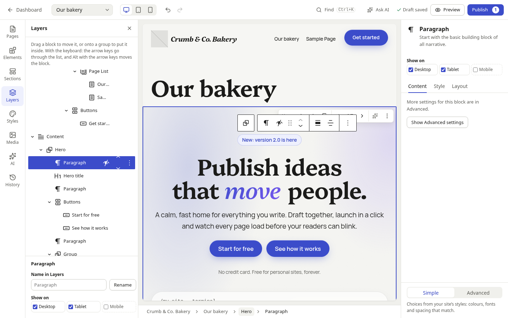

#50 is Elementor's Navigator (`layers-panel.tsx`, with the keyboard moves in `layers-model.ts`). It's the block editor's list view, which already does most of the work:

- **Selection follows the canvas** both ways. Choosing a row selects the block; selecting on the canvas marks its row, expands its parents and scrolls to it.
- **Drag to reorder and nest**, with WordPress's drop line. The up and down arrows on a row move it without dragging. The ⋯ menu has WordPress's own actions (duplicate, group, rename, hide, delete).
- **The keyboard:** the arrow keys move through the tree (WordPress's tree grid). Alt and the arrow keys move the focused row's block, as in the Pages panel: up and down among its siblings, right into the block above it (at its end), left out of its parent (just after it). The block editor's rules decide what's allowed (`canMoveBlock()` and `canInsertBlockType()`: locking, allowed blocks and editing modes, so a block can't leave the page for the template). A polite live region says what happened (*Heading moved into Group.*, *Heading can't move there.*), and focus stays on the moved row.
- **Under the tree**, for the selected block: *Name in Layers* (`metadata.name`, as WordPress's Rename; a blank name, or the block type's title, removes it) and *Show on* ([Responsive editing](#responsive-editing)). The template's regions (header, footer, page content) can't be renamed or hidden here: their attributes belong to the template, which Studio doesn't save.

## Saving: the draft, Publish, Preview, Discard

Studio never writes to the live site on its own ([Principle 4](../plans/visual-site-builder.md#principles)). Every edit goes into the user's open [changeset](changesets.md), and only *Publish* makes it live.

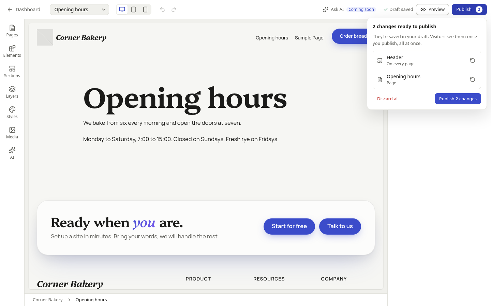

### What the canvas saves

`StudioEditor` knows each region's *live* markup (what visitors see), its *initial* markup (what the canvas opened with: the draft's version, or live) and, for a part, the theme file's markup. A moment after an edit (300 ms; serializing is the expensive part) it works out each region's entry (`desiredEntry()` in `changes-model.ts`):

| The region now | Entry |
| --- | --- |
| Back to what visitors see | none (`null` removes it) |
| A customised part back to exactly the theme's file | `wp_template_part:{slug}: { source: "theme" }` (a reset; publishing deletes the copy) |
| Anything else | `page:{id}: { content }` or `wp_template_part:{slug}: { content }` |

A page's entry is shared with the Pages panel, which writes `title`, `parent`, `menu_order` and `template` into it: each side merges its own fields (`useDraft().wantFields()`, `mergeFields()` in `changes-model.ts`), and an entry left with no fields goes. *Undo* on a page in the Publish list takes out the whole entry: its text and its place.

Markup is compared after a parse/serialize pass, so opening a page is never a change. Only regions edited where the person is working count: a change arrives with the selection in the page or in a part (or comes from undoing one, a Reset or an undo in the Publish list). Blocks that adjust themselves elsewhere on the canvas (a block migrating old markup, say) don't make the header an edit. The Navigation block fills in its fallback menu's `ref` when it loads; that's the menu it shows anyway, so a part that differs only by that (`withoutNavigationRef()`) isn't edited. Once a part is edited, it's saved with the `ref`, so the header names its menu ([navigation.md](navigation.md#why-an-option)).

Some blocks edit records outside the tree, in core-data (`entity-edits.ts`): the site title, tagline and logo edit the site record (`/wp/v2/settings`), saved as `option:blogname`, `option:blogdescription`, `option:site_logo` and `option:site_icon`; the Navigation block edits its menu, saved as `wp_navigation:{id}: { content }`. Nothing goes to their REST routes. A resumed draft's entries are laid back over those records; Discard and Publish clear the edits.

### The draft

`use-draft.ts` keeps the changeset in step: 800 ms after the last change it sends what differs (`entriesPatch()`) with `POST /pressbase/v1/changesets`, which starts the user's changeset or returns their open one. One request at a time; edits made meanwhile go in the next. Values the server stored differently (sanitised for people without `unfiltered_html`) aren't sent again. The top bar says *Saving…*, *Draft saved*, or *Couldn’t save. Try again*.

| Action | Does |
| --- | --- |
| **Publish N** | N is the number of entries in the draft. The button opens a panel listing them in plain words (`describeChange()`: *Footer · On every page*, *About us · Page*, *Site title*), each with an undo button, then *Discard all* and *Publish N changes*. Publishing saves what's pending, then `POST /pressbase/v1/changesets/{uuid}/publish`: everything goes live together. |
| **Undo one change** | On the canvas: the region goes back to what visitors see (one undo step), and the draft follows. Elsewhere (another page, the site title): the entry is removed. |
| **Discard all** | Asks first, then `DELETE /pressbase/v1/changesets/{uuid}` and reopens the page as visitors see it. |
| **Preview** | Saves what's pending, then opens the page with `?changeset_uuid=` in a new tab (the live page when the draft is empty). The preview's *Back to Studio* opens `/admin/studio?changeset_uuid=…`. |
| **Another page** | Saves first, then opens it, with the header and footer as just edited. If saving fails, Studio asks before leaving the edits behind. |
| **Leaving** | While edits aren't saved yet (or saving failed), the browser asks first (`beforeunload`). Saved edits are safe in the draft. |

### Reopening

Studio opens with the user's open changeset: the canvas shows its pages and parts, a toast says how many changes aren't published yet, and if a page or part in it changed on the live site after the draft did (someone published it meanwhile; `changedSince()` compares the entry's `date_modified_gmt` with the page's `modified_gmt`, or the part's `modified` in the site's time zone), a note above the canvas names them: publishing the draft would replace their version.

## The Pages panel

`pages-panel.tsx`, with the arithmetic in `pages-model.ts`. It shows the site's pages as the draft leaves them (`draftPages()`): live pages with the draft's titles, places and templates laid over, then the pages the draft adds. Every change is a changeset entry, so nothing is live until Publish, and Preview shows it.

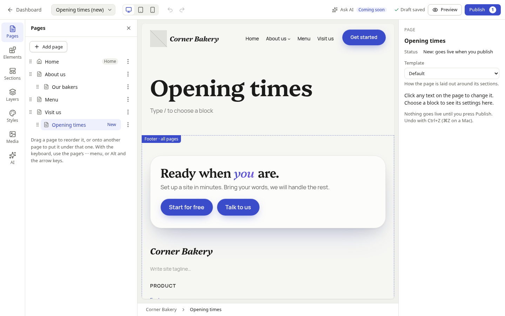

| Action | How | Entry |
| --- | --- | --- |
| Open a page | Click it (Enter on the keyboard) | — |
| **Add page** | The button at the top; a title, then *Add page*. The page opens on the canvas, marked *New*, so its sections can be added at once | `page:{slug}: { title, status: "publish", parent: 0, menu_order }`. Core creates the page on Publish (`postEntityHandler('page', { create: {} })`); the slug comes from the title, made unique (`newPageSlug()`) |
| Rename | ⋯ → *Rename*, in place (Enter keeps it, Escape doesn't) | `title` |
| Reorder | Drag a page above or below another (a line shows where); ⋯ → *Move up* / *Move down*; or Alt+↑ / Alt+↓ on the page | `parent`, `menu_order` |
| Nest | Drag a page onto another (it's highlighted); ⋯ → *Put under …* (the page above) / *Move out of …*; or Alt+→ / Alt+← | `parent`, `menu_order` |
| Home page | ⋯ → *Make this the home page* (published pages, people with `manage_options`) | `option:show_on_front: "page"`, `option:page_on_front: {id}` |
| Template | The inspector, with nothing selected: *Template*, from `/wp/v2/templates?post_type=page` (custom templates for pages, as WordPress's `get_page_templates()`). The canvas reopens in it | `template` (`_wp_page_template`; `""` for the default) |
| Details | ⋯ → *Edit details in Pages* (address, excerpt, featured image…) | — |

- **Order:** a move puts the page at its new place among its new siblings and numbers them again 0, 1, 2… (`movePage()`), so the order holds even where every `menu_order` was 0. Only pages whose parent or number changes get an entry, and a field back to its live value leaves the entry.
- **New pages as parents:** a page can go under a page the draft adds: `parent` names it by slug, and core writes the parent first (`after()` in the entity handler, `orderEntries()`). A new page can be the home page once it's published (it has no ID before).
- **Moves are announced** in a polite live region ("Opening times moved. It's now under Visit us."), and the page keeps focus. A move that can't be (a page under itself or its own child page) says so and changes nothing.
- After Publish, Studio reloads the pages and reading settings, and a page the draft added opens again by its new ID.

### Core support

- `postEntityHandler()` takes `template` (checked against the type's templates, as `check_template()`; written as `_wp_page_template`, as `handle_template()`) and a `parent` given as a slug. A changeset preview shows the template (`ChangesetPreview.templates`, read by `pageTemplateOf()`).
- Previews find moved and created pages at their new address: `get_page_by_path()` (`pageByPath()` in `frontend/query.ts`) and `get_page_uri()` (`pagePath()` in `content/permalinks.ts`) read through the preview.
- REST: pages' `template` field is the chosen custom template (it was always `""`), and the index (`GET /wp-json/`) has `show_on_front`, `page_on_front`, `page_for_posts` and `timezone_string`, as WordPress's has.

### People without design rights

Someone who can edit pages but not the site's design (`edit_pages` without `edit_theme_options`, an Editor by default) can open Studio:

- The Pages panel lists the pages they may edit (their own only, without `edit_others_pages`); adding needs `publish_pages`, arranging `edit_others_pages` (a move renumbers sibling pages), choosing the home page `manage_options`.
- The header and footer are shown but locked (`editingModes(blocks, { partsEditable: false })`). Selecting one says why: *"only people who can change the site's design can edit it"*, in the inspector and above the canvas. The Styles panel says the same.
- Their changes go into their own draft, which core checks entry by entry (`edit_post` on each page).

## The Sections panel

`sections-panel.tsx`, with the grouping and search in `sections-model.ts`. It lists the patterns from `/wp/v2/block-patterns/patterns` that are page sections (`sectionsOf()`): shown in inserters, not for a template part, a header or footer, another post type or a whole new page (`core/post-content`).

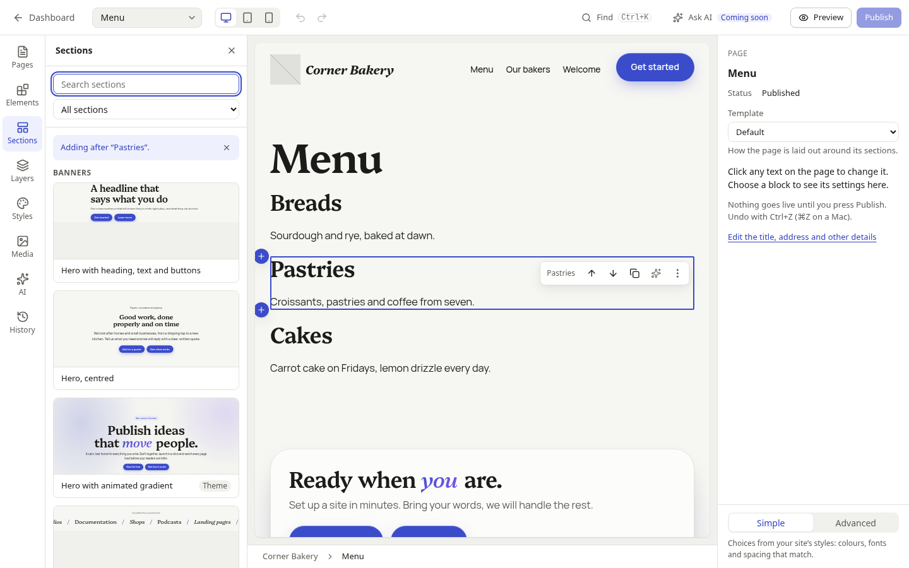

- **Order:** the Pressbase library first (core's `pressbase/*` patterns, `source: core`), then the theme's, then plugins' (marked *Theme* and *Plugin*).
- **Categories:** each section is filed under its first category that isn't *Featured* or the theme's own collection (`pressbase` for `pressbase/pricing`), so library, theme and plugin sections of one kind sit together. A picker narrows to one category (with every section in it).
- **Search:** every word must appear in the title, description, keywords or category names.
- **Previews:** `BlockPreview` from `@wordpress/block-editor`, inside Studio's editor, so they're drawn in the site's own styles. Each is drawn only once it scrolls near view (`IntersectionObserver`), so the panel opens fast.
- **Adding:** click a section (or Enter on it) to add it after the selected section, or at the end; or at the place ＋ *Add section* chose (*"Adding after “Breads”."*, with a button to clear it). Or drag it onto the page: the tile hands the canvas's drop zones the same `wp-blocks` data WordPress's inserter does. Each add is one undo step, saved to the draft like any edit.
- **Its pattern:** a section of one block is added with `metadata.patternName` (`sectionBlocks()`), as WordPress's inserter does, so [Swap layout](#swap-layout) knows where it came from. The name is saved with the page, as WordPress saves it.

### The section toolbar

`section-toolbar.tsx`. Hovering a top-level section (a direct child of the page's content) outlines it and shows a floating toolbar in its top right corner; it also shows for the section that holds the selection, so keyboard users get it too. It's drawn in Studio's document over the iframe, so it follows the canvas in the tab order (←/→ move between its buttons, `role="toolbar"`, labelled *"Section 2 of 3: Pricing"*).

| Button | Does |
| --- | --- |
| ↑ / ↓ | Move the section up or down (`moveBlocksUp/Down`); disabled at the top or bottom |
| ⧉ | Duplicate it |
| ‹ 2/5 › | [Swap layout](#swap-layout): the previous or next layout of its kind (shown when it has others) |
| ✦ | [Ask AI](ai-edits.md#ask-ai) about the section: rewrite, shorten, expand, change the tone, translate or fix the spelling of its text, another change for the AI panel, or a new section below from a prompt |
| ⋯ | Select section, Add a section above / below, Add a section below with AI…, Remove section |

A text block's own toolbar has ✦ *Ask AI about this text* too, for the selected words. Blocks holding a placeholder (`[Add a customer quote]`) are outlined in amber on the canvas, so none is missed; the [checklist](quality-checks.md#before-you-publish) lists them.

*＋ Add section* buttons sit above and below the section and open the Sections panel at that place. They never cover the page (`addButtonPlace()` in `sections-model.ts`): the pill sits in the gap beside the section (at most 20px from its edge) when it fits there; a narrower gap gets a round ＋; where sections touch, the round ＋ sits at the left end of the edge, outside the outline. Both are in the tab order, after the toolbar, with the full name (*Add a section below Breads*). Everything here is also in WordPress's block toolbar and Layers.

## Swap layout

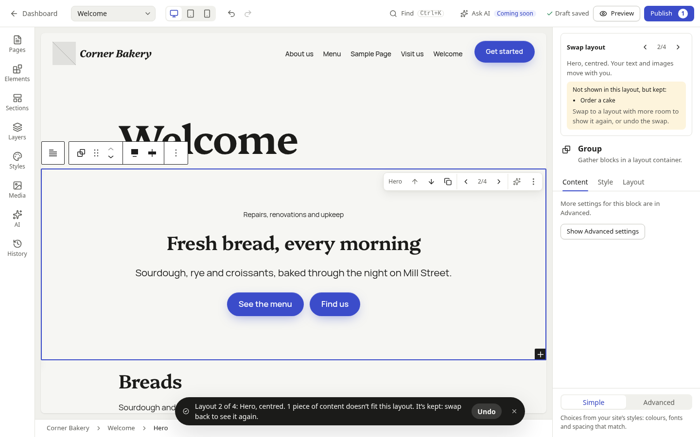

Swap layout (#45) changes a section to another pattern of its kind, keeping its text, links and images: ‹ 2/5 › in the [section toolbar](#the-section-toolbar), the same arrows at the top of the inspector when a section is selected, and *Swap layout: next* / *previous* / *to: {layout}* in the [command palette](#command-palette). The arrows wrap around. `swap-model.ts` does the work (pure, tested); `swap-layout.tsx` has the hook and the controls.

- **Where the section came from** (`sectionLayouts()`): its `metadata.patternName` (sections added from Studio and WordPress's inserter name it); otherwise the single-block pattern with the same *shape* (`shapeOf()`: block names, heading levels and nesting, with runs of alike blocks counted once, so a hero with three buttons matches one with two). A section that matches nothing has no arrows.
- **Its layouts:** the single-block patterns whose categories include the section's own category (`banner` for heroes), in the Sections panel's order: the Pressbase library, then the theme's, then plugins'. ‹ 2/5 › is where the current one sits among them.
- **Moving the content:** `extractSlots()` on the section (with its pattern's declared slots), `transferSlots()` into the next pattern's slots, `fillSlots()`, then `serializeBlocks()` (see [patterns.md](patterns.md#swap-layout)). The new section names its pattern; a name the person gave the section in Layers stays (`personalName()`), one that came with the pattern doesn't. Text the section had nothing for gets a placeholder in the person's language (`withPlaceholders()`: *[Add a short label]*, *[Add text]*; a button group the section had none of keeps one placeholder button), never the pattern's sample text about some other business ([Principle 7](../plans/visual-site-builder.md#principles)); images keep the pattern's picture.
- **One undo step:** `replaceBlocks()` on the section, named in History (*Swapped layout of “Hero”*). The new section is selected without moving focus, so the arrows can be pressed again.
- **Nothing is lost:** content the next layout has no room for (a fourth card in three columns, a third button where two fit) comes back from `transferSlots()` as `unused`. The toast says how much (*1 piece of content doesn’t fit this layout. It’s kept: swap back to see it again.*, with *Undo*), and the inspector lists it under *Not shown in this layout, but kept*. Studio remembers each swapped section's content from before its first swap (`SwapMemory`, by client ID): while the section is as the last swap left it, the next swap starts from that original, so going to a smaller layout and back restores everything. After an edit, the next swap starts from the section as it is; what was left out stays listed (`swapSource()`), so it can still be copied, and undo still brings it back.

## The Elements panel

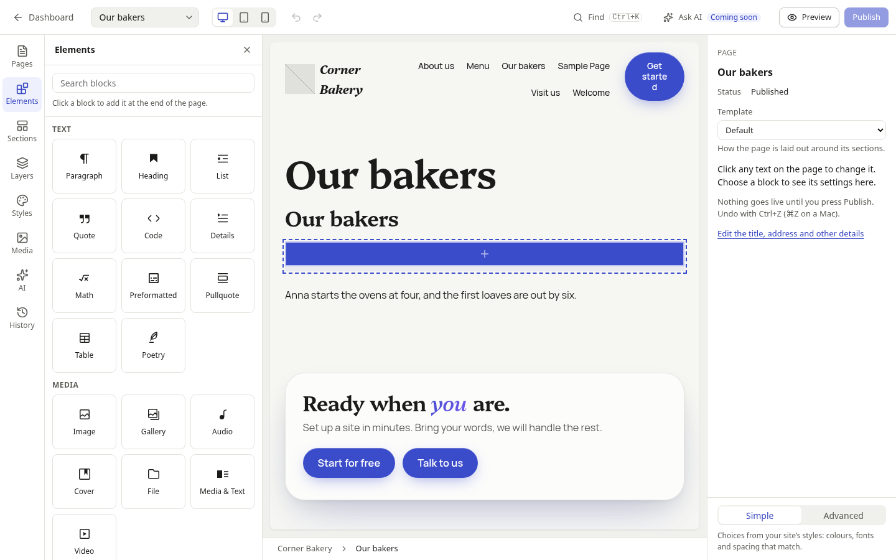

`elements-panel.tsx`, with the grouping, search and insertion place in `elements-model.ts`. Elementor's Widgets panel, for blocks (#35).

- **Which blocks:** the block editor's own inserter list for the page (`getInserterItems()` on the page's content), so a block the page can't take isn't offered, and plugins' blocks appear by themselves. Saved patterns are left to the Sections panel.
- **Groups** (`elementGroupOf()`): *Text* (`text`), *Media* (`media`, `embed`), *Layout* (`design`), *Site* (`theme`, `widgets`, and core blocks of other categories), *Plugins* (any block outside `core/`). Within a group, the block editor's order.
- **Search:** every word must appear in the title, keywords, description or group name, ignoring case and accents. The forty-odd embed services and search-only variations are listed only when searching.
- **Tiles:** a large tile per block with its icon and name, a button named *Add block: Image* (described by the block's description). A block a page can have only once, already there, is shown but disabled.
- **Click (or Enter):** adds the block where WordPress's inserter would (`insertionPlace()`): after the selected block, in the nearest container that takes it; inside a selected empty block that takes it (a column, a group, an empty section); with nothing selected, at the end of the page. A line under the search says where (*Click a block to add it after “Paragraph”.*). It's the block editor's `insertBlock()`, so one undo step, named *Added block “Image”* in History, and the new block is selected.
- **Drag:** a tile hands the canvas's drop zones the `wp-blocks` data WordPress's inserter does, so WordPress draws the drop line between blocks and inserts on drop (one undo step). `CanvasDragAssist` (`canvas-drag.tsx`) adds the rest while something is dragged over the canvas: the group, column or empty section the drop goes into gets a dashed outline and a tint (`data-studio-drop-target`, styled in `canvas.css`; the page's content itself only gets the line), and the canvas scrolls when the pointer is within 60px of its top or bottom edge, faster nearer the edge (`autoScrollSpeed()`).
- **Keyboard:** every drag has a keyboard way. Select the place on the canvas (arrow keys, or Tab into it), then press Enter on a tile, or run *Add block: …* from the [command palette](#command-palette). To put a block in an empty column, select the column first.

## The Styles panel

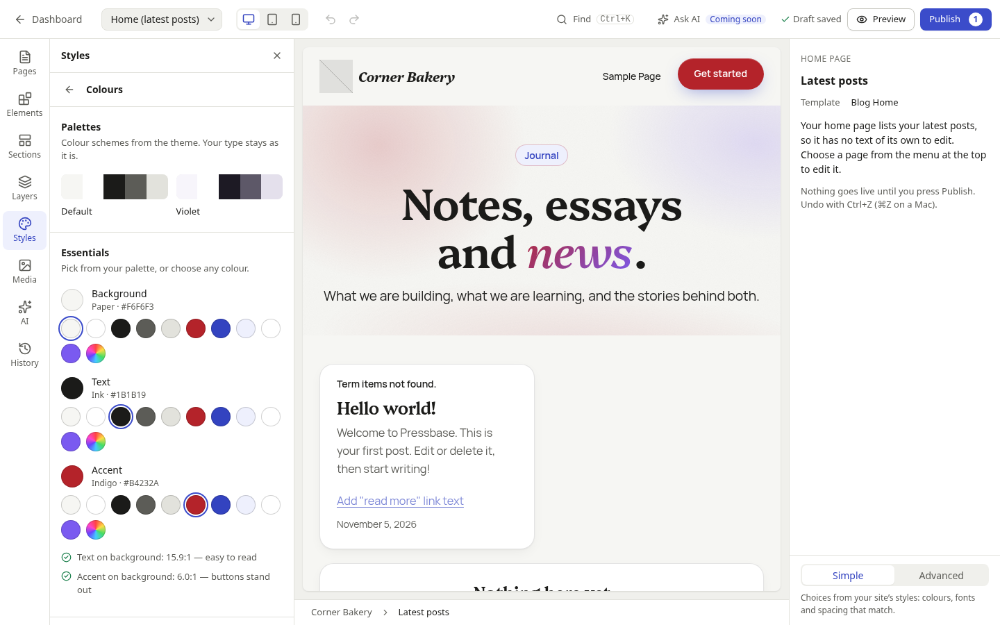

`styles-panel.tsx`, with the data and pure functions in `styles-model.ts` and the draft and canvas wiring in `use-site-styles.ts` (#46). It edits the user's global styles (the custom origin of theme.json) for people with `edit_theme_options`; others see why it's locked.

- **Screens:** a list, then one screen at a time with a back button; a new screen starts on its heading, and going back returns focus to the button that opened it.
  - *Looks*, *Colours*, *Fonts*: Appearance → Styles' own parts (`StylesTab`, `ColorsTab`, `TypographyTab` from `appearance/styles-editor.tsx`), so the two screens can't drift apart.
  - *Spacing and corners*: room between blocks (`styles.spacing.blockGap`) and at the page edges (`styles.spacing.padding` left and right) from the theme's spacing presets; **corners** for the whole site (`CORNER_SCALES`: Square, Subtle, As designed, Round), which scale the theme's `border.radiusSizes` together so every card, image and button that uses them follows (pills stay pills); then the content and wide widths (`LayoutTab`).
  - *Buttons*: the button element's colours (`styles.elements.button`), corners and size (`BUTTON_SIZES`, as padding). A new background keeps a hover colour that follows it (`setButtonColor()`), as Appearance → Styles does.
  - *Blocks*: every block type with style supports, by group, searchable, child blocks included (Button lives in Buttons), with *Changed* on the ones the site styles. A block's screen offers what its `supports` allow (`blockStyleSupports()`, as `wp-includes/block-supports/*.php` reads them): text, background and link colours, font and size, space inside, corners. It shows the theme's value until one is chosen, falling back to the element the block is styled through (`BLOCK_ELEMENTS`: a Button's colours are the button element's). *Use the theme's design for this block* removes `styles.blocks.{name}`.
  - *Additional CSS* (see below).
- **Simple and Advanced:** the design system is in both. Advanced adds borders (width, style, colour), shadows (the theme's shadow presets), hover and focus colours for buttons, any colour beside the palette, and Additional CSS; in Simple, a screen that has more says so, with *Switch to Advanced*. These are `borders`, `shadows`, `states`, `custom-values` and `additional-css` in `CONTROLS` (`mode-model.ts`).
- **Additional CSS:** for the whole site (`styles.css`) and per block (`styles.blocks.{name}.css`, where `&` is the block). Only in Advanced, and only for people with `edit_css` (WordPress maps it to `unfiltered_html`; core drops the CSS for anyone else, through REST and through the draft). Core checks it with `validate_custom_css()` as it's typed (`/pressbase/v1/global-styles/editor-settings`): CSS that could close the style element is refused with core's message and *Remove it to save your styles*, and nothing more reaches the draft until it's fixed.
- **Live, into the draft:** an edit shows in the panel at once. After 150ms (`STYLES_DELAY`) core turns the styles into the block editor's settings (`POST /pressbase/v1/global-styles/editor-settings`, [themes.md](themes.md#the-live-preview)), the canvas and style book redraw with them (`withStyles(library)` lays them over the settings the canvas opened with, web fonts of a typography variation included), and the draft gets `wp_global_styles:{stylesheet}: { settings, styles }` through `useDraft().want()`. Styles back to what visitors see remove the entry. Preset colours are CSS variables, so changing the accent changes every block, button and link that uses it.
- **Styles from elsewhere:** an entry the panel didn't write (History restoring a version, the site builder's draft from prompt-to-site, a resumed draft, an AI edit) is taken up the same way (`isForeignEntry()`), so the canvas always shows the draft's styles. After Publish or Discard, the panel reads the saved styles again.

### The style book

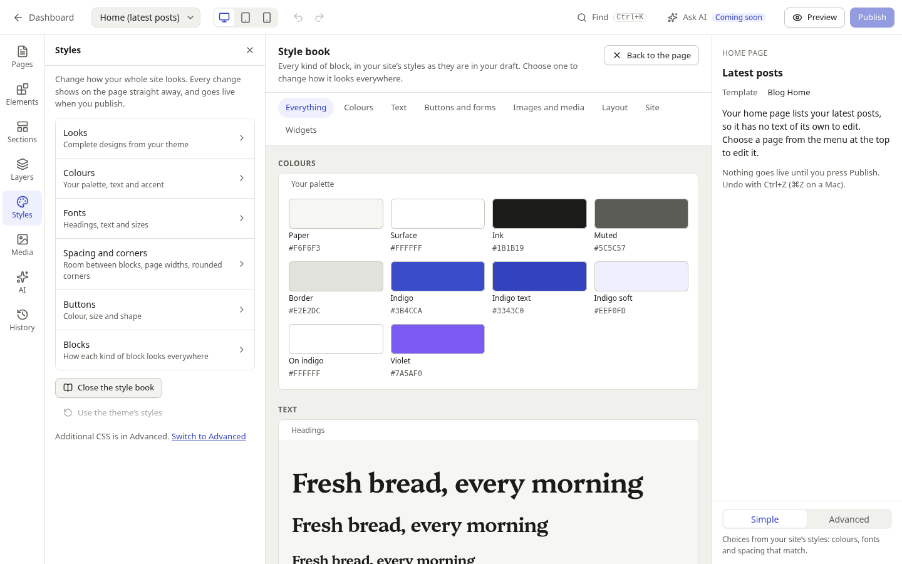

*Open the style book* on the panel's first screen draws it over the canvas (`style-book.tsx`, #47); the page behind is `inert`. It's WordPress's style book (`StyleBookPreview` in `@wordpress/editor`) in plain words:

- **What's in it** (`styleBookSections()`): your palette, then every block type WordPress's style book shows (`getExamples()`: one with an example and offered in the inserter; Headings at four levels), by category: *Text*, *Buttons and forms*, *Images and media*, *Layout*, *Site*, *Widgets*. Each starts with the blocks the Pressbase patterns use most (headings, paragraphs, lists, quotes, details, tables, buttons, search, images, separators, columns, groups); the rest follow by name. Embeds and RSS are left out, since their examples load other sites; Button is shown through Buttons.
- **Drawn in the draft's styles:** each example is a `BlockPreview` inside Studio's editor, without its own `style` attribute (as WordPress removes it, so global styles show), with remote pictures swapped for a neutral one (`exampleAttributes()`). An example is drawn once it scrolls near view.
- **Choosing an example** opens that block's screen in the panel (Buttons opens Button), and the book stays open so each change shows on it at once. The open one is marked (`aria-pressed`).
- **Keyboard:** the book's heading takes focus when it opens; Tab moves through the category filters and the examples (each a button named *Quote, change how it looks everywhere*); Enter or Space opens one; Escape or *Back to the page* closes the book, and focus returns to *Open the style book* (or to the heading of the screen open in the panel).

| Light | Dark |
| --- | --- |
| 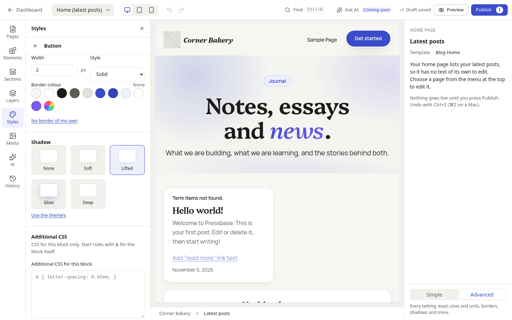 | 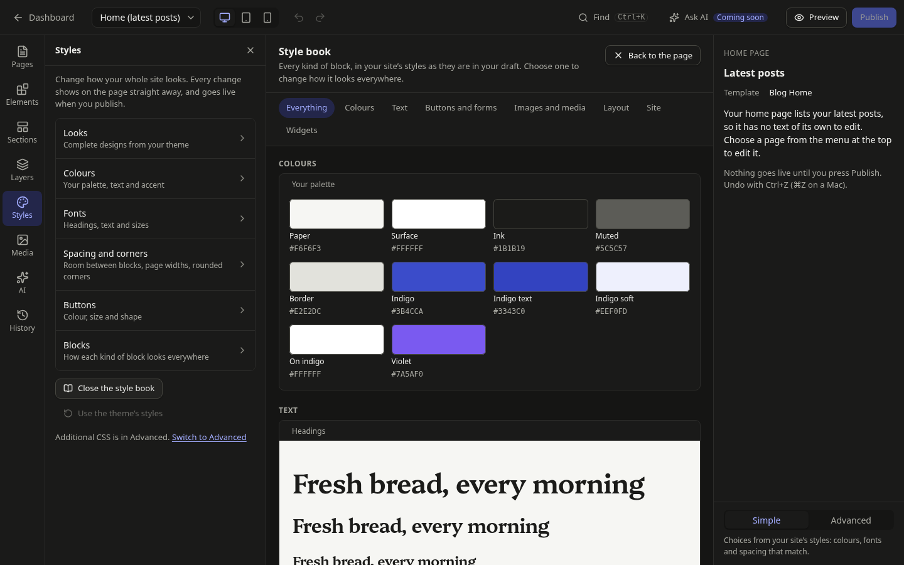 |

## Simple and Advanced

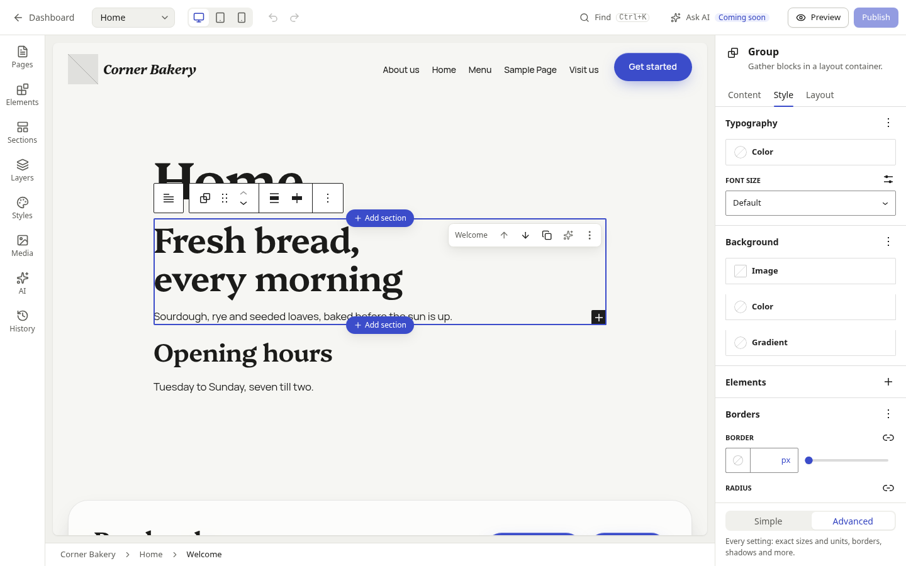

Principle 3 of the [plan](../plans/visual-site-builder.md#principles): beginners see what they need, designers see everything. A segmented control at the foot of the inspector switches between **Simple** (the default) and **Advanced**, with one line on what each shows.

- **Remembered per person:** the `pressbase_studio_mode` user meta (`simple` or `advanced`), registered in core next to the admin colour scheme (`people/user-meta.ts`, [people.md](people.md)). The Studio page reads it from `GET /wp/v2/users/me?context=edit`; a switch shows at once and is saved with `POST /wp/v2/users/me` (`{ meta: { pressbase_studio_mode } }`). If saving fails, a toast says the choice lasts until the person leaves.
- **One map:** `mode-model.ts` says what each mode shows, so later issues add their controls in one place:

| Part of the map | Simple | Advanced adds |
| --- | --- | --- |
| `GROUP_MODES`: the inspector groups (`modeTabs()`, `tabGroups()`) | `default`, `content`, `list`, `styles` (style variations), `typography`, `color`, `layout`, `dimensions` | `bindings`, `advanced` (anchor, CSS classes), `background`, `elements`, `border`, `effects` (shadows), `filter` (duotone), `position` |
| `CONTROLS`: kinds of control, and features still to come (`showsControl()`) | presets, alignment, hiding on a device and values per device ([Responsive editing](#responsive-editing)), [Swap layout](#swap-layout) (#45) | any colour or size, units, line height and letter spacing, borders, shadows, hover and focus styles, Additional CSS ([The Styles panel](#the-styles-panel)) |
| `modeEditorSettings()`: the editor settings | the theme's presets only: `color.custom`, `color.customGradient`, `color.customDuotone`, `typography.customFontSize`, `spacing.customSpacingSize`, `typography.lineHeight`, `letterSpacing`, `textDecoration` and `writingMode` off; spacing units `px` only. Set in `__experimentalFeatures` (and any block's own settings there) and in the top-level switches core moves them to (`disableCustomColors`…), which the block editor reads when the features don't say | the theme's settings, unchanged |

- **Nothing hidden without a word:** when a tab has nothing in Simple but has settings in Advanced (a heading's anchor, say), it says *More settings for this block are in Advanced*, with a button to switch.
- **Adding a control:** add it to `CONTROLS` with the lowest mode that shows it (and its issue, while it's being built); read it with `showsControl(mode, id)`. A new group goes in `INSPECTOR_TABS` and `GROUP_MODES` (a test checks every group is in both).

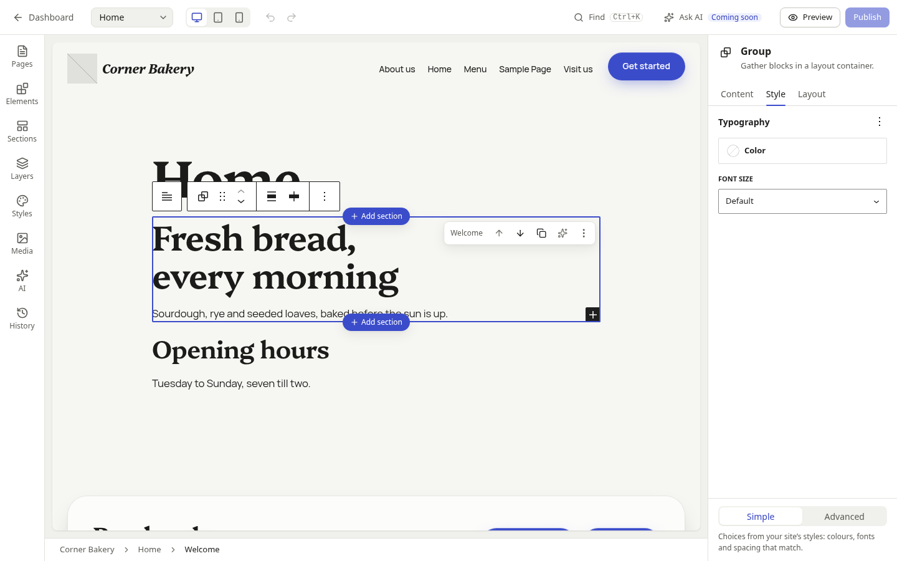

## Command palette

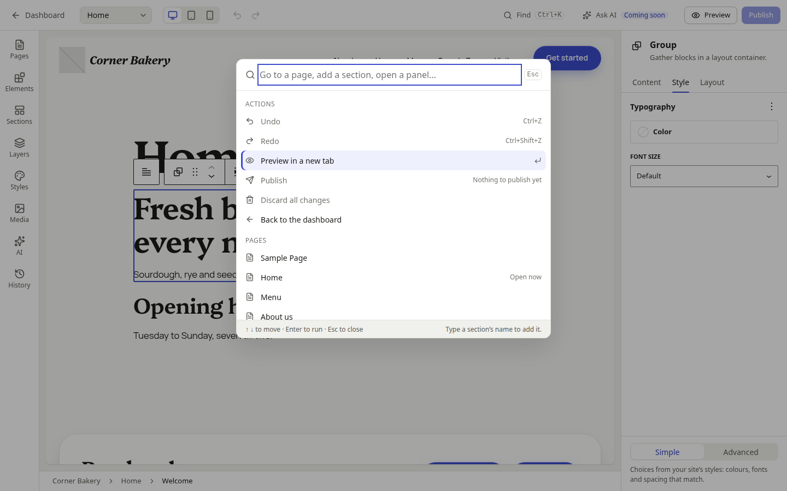

⌘K (Mac) or Ctrl+K, or *Find* in the top bar, opens a palette like Elementor's Finder and WordPress's `core/commands`. Type to narrow; ↑/↓ (and Page Up/Down) move; Enter runs; Escape closes and focus goes back where it was.

| Group | Commands |
| --- | --- |
| Actions | Undo, Redo, Preview in a new tab, *Publish N changes* (opens the Publish list on its button), Discard all changes (asks first), Back to the dashboard |
| Pages | Every page Studio lists (and *Home (latest posts)*), marked *Open now*, *Home page*, *New* or *Draft* |
| Actions (#45) | *Swap layout: next* and *previous* for the selected section (disabled, saying why, when no section with other layouts is selected); *Swap layout to: {layout}* once you type |
| Add a section | *Add section: {name}* for every section in the library, listed once you type; added after the selected section, or last, as one undo step |
| Add a block (#35) | *Add block: {name}* for every block in the Elements panel, listed once you type; added where a click on its tile puts it |
| AI (#62, #63) | Ask AI for a change (opens the AI panel, in its box), Keep and Undo the changes from AI (when a set waits), Start a new conversation with AI, *Add a section with AI…* and *New page with AI…* (a prompt) |
| Panels | *Open the {name} panel* for each rail panel |
| View and settings | Switch to Simple or Advanced settings; switch to Desktop, Tablet or Mobile view |

**The registry.** `commands-model.ts` holds `CommandRegistry` and Studio's instance, `studioCommands`. A command is `{ id, label, group, keywords?, hint?, icon?, disabled?, searchOnly?, run }`; `register()` takes one or a list and returns a function that removes them (registering an id again replaces it). In React, `useStudioCommands(build, deps)` (`command-palette.tsx`) registers while the component is mounted. Studio registers its own in `studio.tsx`; the ones that need the canvas (undo, redo, sections) come from `EditorCommands` (`editor-commands.tsx`) inside the block editor. Groups other than the seven above are listed last, under *More*. The AI commands (#62, `ai-panel.tsx`) are registered the same way, and later plugins' too.

**Search** (`filterCommands()`): every word must appear in the label, keywords or group name, ignoring case and accents. Within a group, a label that starts with the search comes first, then one with it at the start of a word, then one with every word starting a word; the group with the best match comes first. With no search, search-only commands (sections) are left out and the groups keep their order. Each group lists at most 20.

**Shortcut.** A window listener catches ⌘K / Ctrl+K in Studio's own document; key presses inside the canvas iframe don't reach it, so `StudioEditor` passes those on (`isPaletteShortcut()`). A press something else used first is left alone: with text selected, Ctrl+K makes a link, as in WordPress (whose link shortcut applies only to selected text).

**Accessibility** (the WAI-ARIA combobox pattern, in a modal `<dialog>`): the input has `role="combobox"`, `aria-controls` (the listbox), `aria-autocomplete="list"` and `aria-activedescendant` naming the active option, so focus never leaves it; options sit in `role="group"`s named by their heading; commands that can't run now are `aria-disabled`, skipped by the arrow keys, and say why in their hint; the active option has a bar as well as a tint; a polite live region says how many commands match. The dialog is labelled *Command palette* and its input *Search commands*. The *Find* button has `aria-keyshortcuts`.

## History

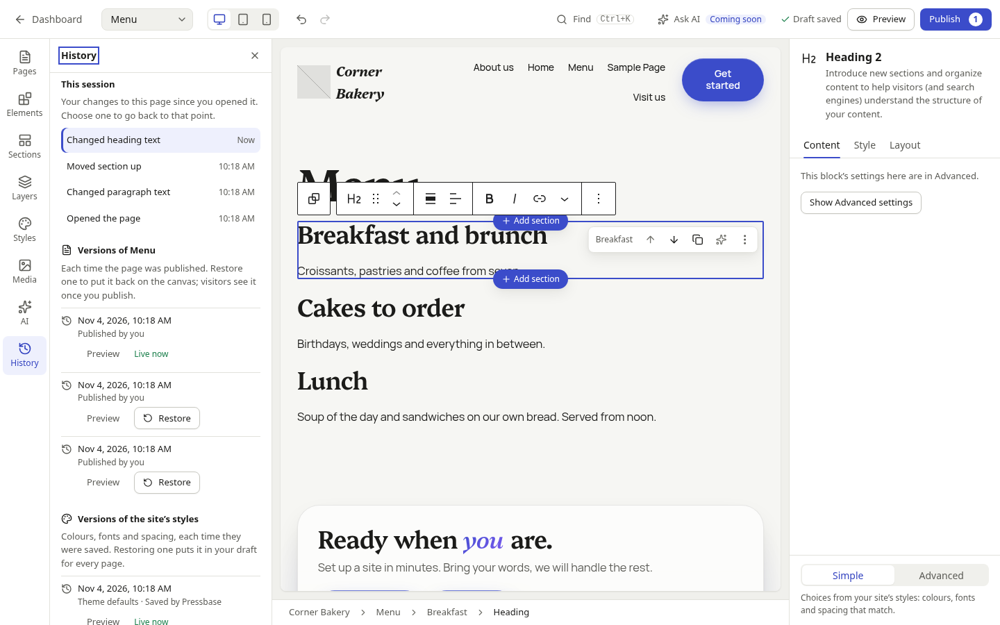

The *History* rail panel (Elementor's History panel) has two parts.

**This session.** Every step since the page opened, newest first, in plain words; the current one is marked *Now*, and steps undone stay (muted, *Undone*) until a new edit replaces them. Choosing one goes back, or forward, to that point; Undo and Redo move one step at a time through the same list. The draft follows the canvas as it does for any edit.

- **The stack:** `useStudioHistory()` (`use-history.ts`) replaces `@wordpress/compose`'s `useStateWithHistory` with the same rules (a *staged* change, such as typing on in the same block, joins the current step; changes before the first step become the starting point), but keeps the steps as a list (`history-model.ts`: `historyRecord()`, `historyGo()`), so the panel can show them and jump.
- **The words:** `describeEdit(before, after, selected)` compares the canvas before and after a step by client ID: text, style, alignment, layout, link, image or description changed; a block added, removed, duplicated, turned into another, moved up or down, or moved into another block; or several blocks changed. `editLabel()` puts that into words: *Changed heading text*, *Moved section up* (a top-level block of the page is a *section* when it moves, comes or goes), *Added section “Pricing”*, *Changed paragraph to heading*, *Changed site title text in the Header*. Block names are their titles, lower case in English only (`blockNoun()`: German keeps its capitals). When two sections swap places, the selected one is the one that moved.
- **Named steps:** a feature that knows better names the next step with `labelNext()`: adding a section from the panel or the palette (*Added section “Pricing, three tiers”*), swapping a layout (*Swapped layout of “Hero”*), adding a block from the Elements panel or the palette (*Added block “Image”*), restoring a version (*Restored the version from …*). Controls on the canvas reach it through `CanvasEventsProvider` (`swap-layout.tsx`).

**Published versions**, below the steps:

- **The page** (a saved one; a page the draft adds has none yet): `GET /wp/v2/pages/{id}/revisions`, newest first, with the date and who published it. The newest, when it matches the live page, says *Live now*. *Preview* opens the version in a large dialog (`BlockPreview`, in the site's styles); *Restore* puts its content on the canvas as one named step, so it's in the draft (`page:{id}: { content }`) and goes live on Publish. The title, place and template aren't restored.
- **The site's styles** (people with `edit_theme_options`): the active theme's user global styles (its `wp:user-global-styles` link) and `GET /wp/v2/global-styles/{id}/revisions`. *Preview* shows the home page with that version in a large dialog (`StylePreview`, core's `POST /pressbase/v1/global-styles/preview`); *Restore* writes `wp_global_styles:{stylesheet}: { styles, settings }` into the draft, listed as *Site styles* in Publish. Preview and the canvas show it ([Styles from elsewhere](#the-styles-panel)).

Nothing here writes to the live site: restoring is a draft change like any other, undone from the Publish list or with Discard all.

## Header and footer in place

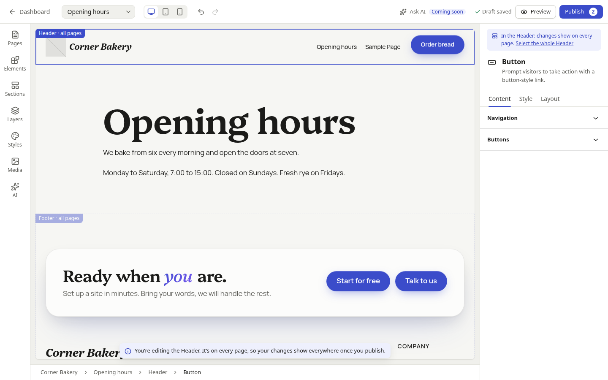

- Hovering a part outlines it with its label; selecting it, or anything in it, keeps a solid outline (`has-child-selected`).
- Before the first keystroke the UI says the part is on every page: a note floats over the bottom of the canvas (*You’re editing the Header. It’s on every page…*), and the inspector shows *In the Header: changes show on every page*, with a way to select the whole part.
- The part's own settings offer **Reset to theme** once it differs from the theme's design: a customised copy (`source: custom` with a theme file), or a part the draft changes. It puts the theme file's blocks on the canvas (`GET /wp/v2/template-parts/{id}?source=theme`), one undo step; publishing deletes the copy.
- Edits are saved as `wp_template_part:{slug}` entries, never straight to `/wp/v2/template-parts`. Publishing the first edit of a theme's part makes its customised copy ([changesets.md](changesets.md#templates-and-template-parts)).

## Keyboard and accessibility

- The first Tab stop is *Skip to the page*, then the top bar, the rail, the canvas, the breadcrumb and the inspector, in that order.
- ⌘K / Ctrl+K opens the [command palette](#command-palette) from anywhere, the canvas included.
- In the canvas, WordPress's keyboard model applies: Tab enters at the first selectable block (the header), the arrow keys move between blocks, Enter starts editing, Escape returns to selecting. Ctrl/⌘+Z and Ctrl/⌘+Shift+Z (or Ctrl+Y) undo and redo from anywhere.
- The device switch is a fieldset of toggle buttons (`aria-pressed`), each with its range in its tooltip; *Show on* is a fieldset of checkboxes; the per-device resets name what they reset (*Reset Font size for mobile*); Layers moves blocks with Alt and the arrow keys and says what happened; the rail buttons have `aria-expanded`; the inspector tabs are a WAI-ARIA tablist (arrow keys, Home, End); the breadcrumb is a `nav` with `aria-current="location"` on the last step, and each step says its level to screen readers ("Section: Hero").
- Landmarks: the top bar (`header`, with a visually hidden `h1`), `nav` *Studio panels*, the open panel (`aside`, labelled by its heading), `main` (the canvas and breadcrumb), `aside` *Settings*.
- Under 900px the inspector becomes a drawer opened by *Settings* in the top bar (Escape closes it), panels slide over the canvas, and the device switch and Ask AI are hidden. Under 600px the rail shows icons only and the canvas uses the whole width.
- Animations stop under `prefers-reduced-motion`.

| Dark | Mobile |
| --- | --- |
| 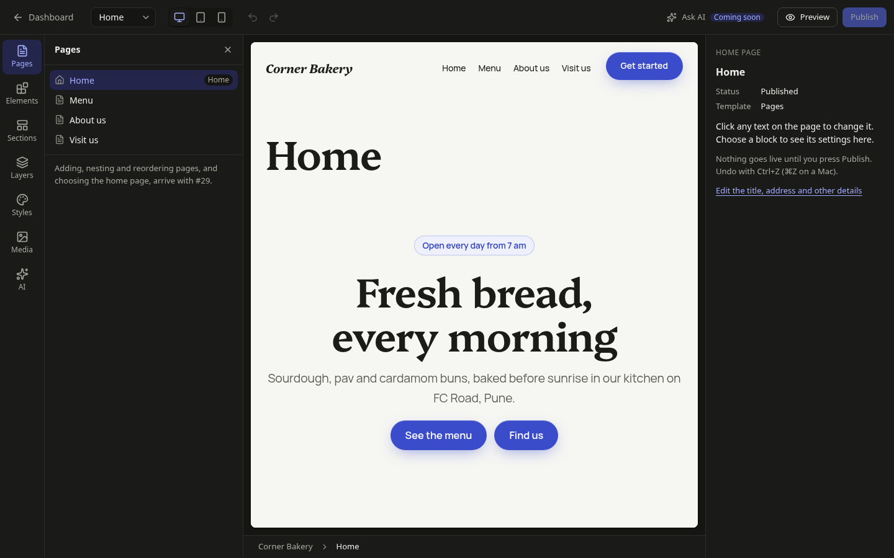 | 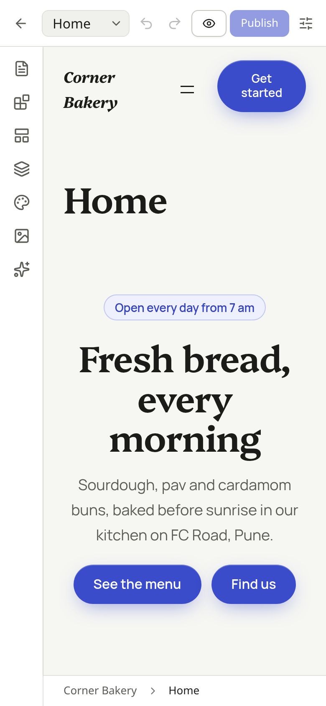 |

## Where the next issues plug in

| Issue | Where |
| --- | --- |
| Plugins' commands | `studioCommands.register()` or `useStudioCommands()` (`commands-model.ts`, `command-palette.tsx`); the AI commands (#62) are registered this way, in `ai-panel.tsx` |
| #36 Context menu, #37 handles | the canvas in `StudioEditor`; the menu's *Ask AI* calls `useAskAiOpener()` (`ask-ai.tsx`) with `{ kind: 'section', section: readSection(…) }` or a `text` target, as the section toolbar does |
| Anything that proposes changes | `useStudioAi().edits.apply()` applies any set of [operations](ai-edits.md#the-operations) with Keep and Undo; `editor.canvas` (`AiCanvas`) replaces regions as one named step |
| Per-device site styles and layout | `deviceTabs()` and `DEVICE_GROUPS` (`responsive-model.ts`) say which inspector groups edit one size; the Styles panel would write `styles.blocks.{name}["@mobile"]` |

## Tests

- `components/studio/canvas-model.test.ts`: composing the canvas, regions, editing modes, the part a block sits in, the Navigation block's fallback `ref`, the breadcrumb.
- `components/studio/changes-model.test.ts`: which entry a region needs (content, reset, none), what to send, the order and wording of the Publish list, the site record's options, and drafts overtaken on the live site.
- `components/block-editor/blocks.test.ts`: the site-editing blocks in Studio only.
- `apps/core/src/changesets.test.ts`: `source: theme` entries (reset a part).
- `components/studio/site-model.test.ts`: which page opens, template candidates, the page tree.
- `components/studio/pages-model.test.ts`: the draft's pages and home page, new pages' slugs and addresses, moves (up, down, in, out, drops), the entries they make, shared page entries, who opens which pages.
- `components/studio/sections-model.test.ts`: which patterns are sections, their order and categories, search; where ＋ Add section goes (in the gap, round, outside the outline).
- `components/studio/swap-model.test.ts` (#45): a section's pattern by name and by shape, its layouts, moving the text there and back, what a smaller layout leaves out (a fourth card), names kept or not, starting again from the original until an edit.
- `components/studio/elements-model.test.ts` (#35): groups (plugins' blocks under Plugins, saved patterns left out), search by title, keyword, description, group and translated group, where a click puts a block (after the selection, into an empty column, up to the container that takes it, at the end), auto-scroll speeds.
- `apps/core/src/changesets.test.ts` (#29): pages created by slug, nested under a new page, with a template; a preview at the new address; refusals.
- `e2e/tests/studio-panels.spec.ts`: add a page, nest it (drag and keyboard), set the home page, publish; Edit with Studio from Pages and the editor; an editor with the header, footer and styles locked; a pricing section added between two others, moved with the toolbar and undone, then published.
- `components/studio/layout-model.test.ts`: the tabs cover every inspector group; the rail's panels each name their issue; device widths.
- `components/studio/responsive-model.test.ts` (#49): breakpoints sanitised as WordPress does, canvas widths inside the theme's ranges (a size without a breakpoint left out), the inspector's groups per device, values inheriting downward (copied, kept, updated, removed, reset to Tablet's), a device's values and resets, labels, `blockVisibility` read and written.
- `components/studio/layers-model.test.ts` (#50): Alt and the arrow keys as moves, where each move goes (or nowhere), the template's regions left alone.
- `e2e/tests/studio-responsive.spec.ts` (#49, #50): a heading made smaller on Mobile (the dot, the reset, the draft's `@mobile`) and a paragraph hidden on desktop, published and checked at a phone's and a computer's width; a Tablet value carried down to Mobile and shown there as inherited; Layers following the selection both ways, moving a block with Alt and the arrow keys (announced, focus kept), renaming it and hiding it on mobile.
- `components/studio/mode-model.test.ts` (#32): every group in a mode, what Simple and Advanced show, no controls left to come, the editor settings Simple turns off (blocks' own settings included).
- `apps/core/src/people.test.ts`: `pressbase_studio_mode` per person, validated.
- `components/studio/commands-model.test.ts` (#33): registering, replacing and removing commands, listeners, search by words, keywords and group, accents, ranking, search-only commands, limits, unknown groups.
- `components/studio/history-model.test.ts` (#34): the stack (steps, staged changes, undo, redo, jumping, a new step dropping undone ones) and every step's words: text, style, alignment, settings, images, links, descriptions, moves up, down and into a block, added, duplicated and removed sections and blocks, a block turned into another, a change in the Header, several blocks, lower case in English only.
- `e2e/tests/studio-modes.spec.ts`: Simple hides borders and Advanced shows them, remembered when Studio reopens; the palette from *Find* and from Ctrl+K in the canvas, going to a page, a device and a panel, adding a section, nothing matching, Discard all; History naming a step, going back and forward, previewing an older published version and restoring it, then publishing it.
- `apps/core/src/block-editor-settings.test.ts`: `/wp-block-editor/v1/settings`.
- `e2e/tests/studio.spec.ts`: opening a page with its header and footer, inline editing, undo and redo, selecting the header, Publish through a changeset, and the keyboard path.
- `e2e/tests/studio-swap-elements.spec.ts`: a hero swapped through three layouts and back with the same text, one undo step per swap, named in History, from the toolbar, the inspector and the palette; an Image dragged into an empty column (lit up while over it) and undone, a block added after the selection with the keyboard, and from the palette.
- `components/studio/styles-model.test.ts` (#46, #47): the draft entry (only settings and styles, none when the styles are live, entries from elsewhere taken up), block supports read as WordPress reads them, resetting a block, presets by origin, corner scales (pills kept), button sizes and hover colours, Additional CSS in Advanced only and for `edit_css`, the style book's sections (every block with an example, common ones first, embeds, RSS and Button left out) and examples without their own styles or remote pictures.
- `apps/core/src/studio-styles.test.ts` (#46): editor settings for unsaved styles (the new palette, nothing stored, starting from the saved styles, `edit_theme_options` only); Additional CSS for the site and each block kept with `edit_css` and dropped without it, through REST and a changeset; CSS that could close the style element refused for the site, a block and a block's style variation.
- `e2e/tests/studio-styles.spec.ts`: the accent changed in Colours turns the header's button on the canvas and goes into the draft, then back to the theme's; a draft's styles made elsewhere (as the site builder makes them) on the canvas and in the panel; Advanced: the site's Additional CSS on the canvas, `</style>` refused with the draft keeping the last good CSS, a Quote's border; the style book's categories, a filter, an example opened with Enter and the book closed with Escape.
- `components/studio/ai-edits-model.test.ts`, `ai-panel-model.test.ts` and `e2e/tests/studio-ai.spec.ts` (#57, #62): see [AI edits](ai-edits.md#tests).
- `components/studio/ask-ai-model.test.ts`, `checklist-model.test.ts`, `apps/core/src/studio-ask-ai.test.ts` and `e2e/tests/studio-ask-ai.spec.ts` (#61, #63): see [AI edits](ai-edits.md#tests) and [Before you publish](quality-checks.md#before-you-publish).
- `e2e/tests/studio-saving.spec.ts`: an edit saved to the draft, reopened, previewed and published; undoing one change from the list and Discard all; the footer edited on one page and shown on every page, then Reset to theme.

## Not yet

- The featured image, excerpt and address in Studio (⋯ → *Edit details in Pages*). A renamed page's Title block on the canvas shows the saved title until Publish (a page the draft adds shows its title: the template's Title block is drawn as a heading, `withDraftTitle()`).
- Making a page the draft adds the home page before it's published, and removing pages (trash isn't a changeset entry yet).
- Editing the template itself (the page title, layout groups).
- People without `edit_theme_options` see an empty Navigation block in the header: menus (`wp_navigation`) need that capability, as in WordPress.
- Undo and redo of edits made outside the block tree (site title, tagline, logo, menu items): core-data keeps their own history. Undo one from the Publish list instead.
- *Create new menu* in the Navigation block saves that menu straight away, as in WordPress; only pointing the header at it waits for Publish.
- Telling apart "someone else published" from "you saved it in another screen": both show the note on reopening.
- History starts again when another page opens (each page has its own canvas and undo history), and doesn't list edits outside the block tree (site title, menus).
- The Styles panel has no per-device values (`styles.blocks.{name}` could take `@tablet` and `@mobile` beside the desktop values, [ADR 0023](../adr/0023-responsive-styles-and-breakpoints.md)), no gradients or duotone, and no element styles besides buttons and links (captions, cites, headings by level). Fonts are the theme's and its variations' (no font library yet).
- The style book draws theme blocks (post title, comments…) without a post, as WordPress's does, so some show placeholders.
- Simple narrows the inspector, not the block toolbar.
- Plugins can't reach `studioCommands` yet: it needs a place in the plugin SDK's admin API.
- Swap layout swaps only sections of one block, and between patterns of one block, as WordPress's *Change design* does. Its memory of what a smaller layout left out lasts while the page is open.
- A section built some other way that happens to have a pattern's shape is offered that pattern's layouts; a section whose shape no pattern has gets no arrows.
- Per-device layout and position (`style["@mobile"].layout`): the public site doesn't print them yet (ADR 0023), so the inspector doesn't offer them on Tablet and Mobile. Per-device block gap sits in the Dimensions panel but, like layout, isn't printed yet.
- WordPress's own reset on a Mobile value that came from Tablet does nothing visible (it goes back to Tablet's value, which it already had); Studio's list shows such values as *From Tablet*, without a reset.
- A block hidden on a size is still in the page's HTML there (WordPress's `display: none` classes); only `blockVisibility: false` leaves it out.
- The private block-editor APIs Studio opens for responsive editing can change with a WordPress release: the packages are pinned, and the e2e tests cover them.
- The Elements panel has no "most used" row yet, and its tiles can't be dragged by keyboard (Enter on a tile after selecting the place does the same).
